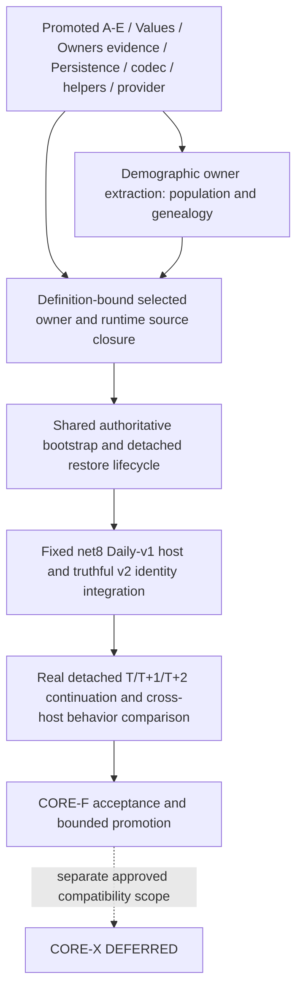

# CORE-F Daily-v1 closure execution contract

**Architecture planning base:** `4b69e43516b3fc548611ce704ef45af9e54e3d0e`.
**Inspected production:** `codex/core/canonical` at `0094febf7f97333d0653eaf9688fe1d24d73327f`.
**Disposition:** reviewed bounded source-extraction preparation; no production change. Readiness below takes effect only after independent PASS and architecture publication. Full CORE-F remains `WAIT_DEPENDENCY`; CORE-X remains `DEFERRED`.

## 1. Current facts and authoritative evidence

Remote refs, source blobs, production State and the latest implementation review were inspected. The architecture checkout has older executable source: Master imports only the reviewed documentation delta into current Core, never this branch's executable tree. A stale local Core branch is not the execution baseline. No numbered-phase canonical or active implementation checkout is modified.

CORE-A–E, selected Values/Owners/Persistence, the shared frozen P18-D codec, numeric compatibility helpers and Unity provider switch are promoted. The [latest Core validation/review](https://github.com/TorroisBr/Simulation/tree/0094febf7f97333d0653eaf9688fe1d24d73327f/docs/validation/CORE_F_NullRosterProviderSwitch) records Unity3176/3176, .NET171/171 cold/warm, Smoke5/5. These are retained implementation results, not new runs by this documentation wave. Their source algorithms remain closed except the genealogy restored-clone revision-loss correction demonstrated below; this does not reopen a Phase.

The actual source graph is still substantial:329 application source nodes,2990 unique file-pair edges,128 SCCs;235 runtime-reachable and303 restore-reachable nodes, including68 restore-only nodes. The largest SCC has191 files. Thirty explicit SDK production Compile links already consume shared Core package source. Reachability is within Assembly-CSharp; Core metadata edges are separate. The graph is not a method-call trace, profile admission proof or instruction to move303 files unchanged. See the [current graph provenance](../validation/CORE_F_ClosurePath/README.md).

The accepted selected owner shape remains **61 + 22*N + U + P + 4*C**, across89 family definitions; initial populated fixture counts do not replace exact keys, roles, aliases or zero requirements. The promoted24-operation evidence baseline is reused. Required-zero families remain real owners; ExplicitlyEmpty/allowed not-composed branches retain exact rejection rules. New adapters cannot omit inconvenient branches or fabricate census providers.

## 2. Exact remaining dependency graph

The D→C edge means the common integration consumes D's resulting source/assembly interfaces; independent design of C/R/H is safe now. It is not a claim that population/genealogy alone close City/Person/NPC/lifecycle. R and H can be prepared alongside C; their production integration consumes its actual compiled source and constructor interfaces. No edge from unrelated numbered phases or all possible domain extractions is introduced.

### Dependency, missing code versus evidence, ownership and objective exit

| Dependency | Reusable capability | Exact missing code | Missing evidence and objective exit | Implementation owner / concurrency |
|---|---|---|---|---|
| Selected population/genealogy owners | Core PersonId, demographic policy, stable key encoder; actual Unity count/receipt/parentage owners | Move real owner algorithms to package; narrow same-object read-only guard binding, immutable transfer/staged factories and named cross-assembly operations; keep original Unity writers and P12 adapters | Engine-free SDK execution of actual owner state and rejection semantics, unchanged Unity writer/census/codec/restore behavior; all named accesses accounted for | One demographic-owner integration owner; population/genealogy implementation may run in isolated worktrees after common guard contract is fixed; project/asmdef and runtime binding merge serially |
| Remaining selected owners and writers | Complete89-family owner/writer/capture/target evidence baseline | Definition-bound City/NPC/Person, economy/travel/Knowledge, crime, political/institution/property, military and command authorities still compile in Unity application source; extract complete semantic closures and named adapter cuts | Per-family live instance, all admitted writers, revision/epoch commit, export, decoder/hydrator, references and exact rejection mapped to compiled same-source implementation; updated semantic compile graph has no unresolved engine edge | Source/runtime integration owner; read-only domain analysis parallel; actual shared runtime/census/owner integrations serialized |
| Writer/revision/epoch coverage | Current P12 operation contexts, owner hooks, admission, mutation epochs and cumulative24-route tests | Preserve and reconnect exact hooks across assembly moves; no replacement global lock, second protocol or universal per-operation epoch increment | Every supported ingress retains its current successful commit and invalidation behavior, including failed/rejected/rolled-back/read-only behavior. Wrong thread, absent/wrong context and changed-token paths reject as before | Same owner as affected authority; runtime/P12 hotspots serialized |
| Unity-independent definition consumption | Promoted immutable typed graph, effective config/calendar,164-field parity and separate P9/P12 identities | Runtime still holds Unity authoring references; bind exact graph-issued typed nodes; provide actual pure semantic types for any compiled optional dependencies without adding profile content; preserve adapters | Complete field/default/order/enum/reference-use table and same-input effective fixture parity; no live owner consults ScriptableObjects in .NET | Definition conversion/source owner; adapter/fixture preparation parallel, runtime integration serial |
| Shared bootstrap/runtime | Current SimulationRuntime, staged genesis, time/admission/lease/token, manifest and identity | Move real semantic constructor/bootstrap/application boundary; keep Unity lifecycle/SO/environment/logging in adapter | Same stage/callback/publication order, WorldId only after healthy completion, one guard/clock/epoch/token authority; selected world executes without Unity | One runtime integration owner |
| Shared restore lifecycle | P12 C/D/E/F staging, graph validation, guard binding, recapture and restored admission | Move actual coordinator and staged constructors with shared owner types; remove TesteSimulacao formatter/environment edge; one shared session publication path | Real image→private graph→binding validation→fresh vector→admission→one exchange; rejection/throw retains old world and slot. No genesis, RNG draw or token fabrication during restore | Runtime + persistence integration owner, serialized |
| Detached .NET construction and compatibility | Shared descriptor v2, wire and AtomicFileSlot algorithms | Fixed net8 host, same effective fixture, complete real assembly anchors, descriptor-v2 wiring into image/header/codec/store and host facade | Truthful host/RID/runtime/architecture/build/content identities; v1 Unity behavior unchanged, incompatible descriptors rejected before staging; .NET starts without Unity assemblies or installed Unity | Host adapter owner after shared API closure; fixture/project preparation isolated, final integration serialized |
| Deterministic continuation and Unity/.NET parity | Existing Unity continuation and bounded Core tests | No alternate rules; implement host test harness around shared runtime | Actual save at positive T, process-detached restore and ordinary T+1/T+2 in .NET; repeated round trips versus uninterrupted same-host control; full owner/root/output comparison across hosts for matching inputs | Independent validation owner, one Studio validation/import window; exact-tip independent review |

This is an incremental source migration, not a second authority. A complete owner package may keep its *existing* writer implementation in Unity temporarily when the full source/access ledger explicitly represents that caller and preserves the same owner instance and callbacks. That package does not satisfy the full .NET-host writer closure. Moving every caller at once is unnecessary; losing a caller, epoch hook, staged factory or supported rejection is prohibited.

### Source-confirmed correction inside the owner package

The current Genealogy staged factory preserves Revision, but SimulationRuntime unconditionally clones by replaying current edges. An admitted add then remove gives Count0/Revision2; the private restored runtime clone becomes Count0/Revision0. Both P12-G restore routes use this constructor; no later revision installation exists. Independent source review confirms this counterexample; it has not been executed in this architecture wave. Existing target-vector comparison should reject the mismatch, so no wrong world publication is claimed. The genealogy design fixes only the internal restored-context clone via exact immutable export/staging; ordinary construction and rejection/vector guarantees remain intact. Authentic capture and persisted restore regressions are mandatory in the implementation package.
## 3. Next executable package and Master dispatch

The [demographic owner Master handoff](CORE_F_DEMOGRAPHIC_OWNERS_MASTER_HANDOFF.md) combines two independently analyzed source closures: seven population files and two genealogy files. It advances actual engine-free authoritative owners rather than adding another unused value copy or identity microtype. No new checkpoint or Phase ID is created.

After independent design PASS and architecture publication this package is **READY_FOR_IMPLEMENTATION** under Master's existing Core mandate. Its detailed designs fix interfaces, rollback, original same-object guard identity, owner writers and P12 adapters. This readiness is bounded to that package. Whole CORE-F remains WAIT_DEPENDENCY.

Master first imports only these approved docs into current Core and checks intervening source changes. Bind the original single Runtime guard through `IAuthoritativeMutationStatus`; do not add a latch, fault setter or general synchronization framework. Population/genealogy source work may run independently after that one contract, with one owner integrating SDK links/asmdef, Unity runtime bindings and persistence callsites. Each candidate needs ordinary independent implementation review, evidence and Core promotion. Do not rerun or relabel the already delivered provider switch.

## 4. Remaining runtime/definition integration contract

The remaining191-source cycle is not a file-move authorization. Its concrete host cuts are definition-object references, Unity attributes, selected Mathf calls, authoring validators, environment/diagnostics and the formatter/session dependency. Numeric algorithms and frozen P18-D causal payloads already have shared compatible implementations; reuse them and preserve their byte/vector contract. Still replace actual selected numeric callsites during the relevant source cut rather than claiming helper delivery changed those callers.

For live definition handles, retain canonical **object identity** where current rules require it. A single `DailyV1EffectiveDefinitions` supplies interned typed nodes. Stable IDs are lookup/wire identity; do not replace Market/Inventory identity or `NpcRuntime`/`NpcActionRuntime` action-slot `ReferenceEquals` with arbitrary string equality. Unity's asset↔node mapping must bind the admitted canonical object, not silently merge a second unbound object that repeats an ID. Hydration resolves against the same graph and rejects missing/wrong references before publication.

The promoted typed maps cover City/Item/NPC/Job/Action/Status values; live capability/trait consumers still reference pure semantics mixed with Unity authoring types. Missing typed runtime contracts must be split from their real source semantics if compiled consumers require them. The selected fixture contains no capability/trait assets; that is not permission for stubs, fabricated defaults or profile widening. No independent definition lookup layer is needed merely to restate the existing copied graph.

The [shared runtime/restore integration design](CORE_F_RUNTIME_RESTORE_INTEGRATION_DESIGN.md) fixes ownership, lifecycle and host cuts. It remains **WAIT_DEPENDENCY** for implementation on the complete selected source/member closure and resulting APIs. Its bounded preparation is technical, not a human product gate. Freeze the member-level source/access ledger against the post-owner candidate graph before dispatching the remaining runtime integration. Neither whole-file counts nor a prose source anchor list may be labeled implementation ready.

Implementation order inside that common integration is: canonical definition handles and authoring adapters; selected owner/writer semantic source and P12 plumbing; same SimulationRuntime/bootstrap/time; detached restore and publication; net8 facade/identity wiring; cumulative acceptance. Partial commits may compile behind the current host, but no public host claim precedes complete closure.

## 5. Finite final CORE-F acceptance

Use current production [OwnerClosure evidence](https://github.com/TorroisBr/Simulation/tree/0094febf7f97333d0653eaf9688fe1d24d73327f/docs/validation/CORE_F_OwnerClosure): `OWNER_WRITER_MATRIX.csv`, `OWNER_CAPTURE_TARGET_CROSSWALK.csv`, `OPERATION_CASE_MAP.csv`, `CASE_MAP.csv`; and the [P12-G closure matrix](https://github.com/TorroisBr/Simulation/blob/0094febf7f97333d0653eaf9688fe1d24d73327f/docs/validation/P12GPoliticalBindingClosure/CLOSURE_MATRIX.md). Map each finite obligation to actual resulting .NET/Unity cases, its complete input identity and results. Coverage is source-linked, not arbitrary new test count accumulation.

Retain the49 historical CORE-B case identities from `docs/validation/COREB_DeterministicTemporal/TEST_CASE_IDENTITY_MAP.md` as regression identities. They are **not** the full P12-G or new-host acceptance inventory. Add new host cases without renumbering historical cases; derive actual full-suite counts from the final test inventory.

For the exact admitted effective fixture and every supported reachable owner/ingress obligation:

1. Construct and publish a healthy world using the shared authoritative bootstrap; verify complete selected family sets, dynamic keys, aliases and causal roots.
2. Obtain a token only through a fully successful positive outer advance. Failed, partial, throwing, faulted or merely idle states remain capture-ineligible. Tokens remain runtime/context/config/calendar/world/day/sequence/epoch/vector-bound ephemeral evidence.
3. At positive T, continue one control uninterrupted. Capture/save the other and terminate its process. A new .NET process receives only the same effective inputs, truthful same-build identity and saved bytes; no source world object, token, seeded owner override or old formatter closure is available.
4. Strict decode, private C/D/E/F staging, complete merged graph validation, same guard binding, fresh vector recapture, restored-boundary admission and one publication reproduce T. Restore does not rerun genesis, allocate a new WorldId, consume RNG or replay already-applied effects.
5. Ordinary successful advances to T+1 and T+2 match the control's complete owner rows, roles, aliases, revisions, epochs, RNG, allocators, sequences, manifests, event/decision results and receipts. Repeat round trips at later boundaries. Restored provenance remains distinct until the next successful outer advance.
6. For matching common inputs, compare the same authoritative projections and outcomes in Unity and .NET. Host-specific compatibility descriptors/MVIDs are truthfully different; require exact equality only for the shared wire/causal payloads whose contracts require it. This is behavioral parity, not cross-host save loading.
7. Exercise the retained finite malformed/missing/duplicate/unsupported owner, binding/stage/callback, stale/thread/lease/token, descriptor/size/checksum, restore recapture/publication and atomic-file failure obligations. Failures retain prior live world, slot bytes and expected rejection category.
8. Run full .NET cold/warm from the same production package bytes, Unity focused bootstrap/asset/P12 plus ALL EditMode and official Smoke. Run required LongRun for daily-loop/causal-order changes. Preserve complete retrievable NUnit/TRX, source/test/effective-content/toolchain/assembly manifests, exact-tip independent review and `git diff --check` under current evidence policy.

Only all these exits permit CORE-F bounded promotion. Existing Unity P12 evidence is reusable as the behavioral baseline, never a substitute for new detached .NET execution. P12 remains closed only within its accepted Unity scope; this plan infers no P13 or CORE-X readiness.

## 6. Migration, rollback and complexity

First package is bounded: nine actual owner source files, with seven population files totaling1379 lines plus717 lines in the two genealogy files:2096 baseline lines total (see source ledger). Existing writer and codec code remains authoritative, with narrow callsite adaptation. Complexity is moderate: one guard-interface inversion, cross-assembly snapshot/stage operations and a captured owner-bound rollback witness; no new gameplay.

Full runtime closure is **high complexity**, based on the measured191-file strongly connected runtime/census group (109892 baseline source lines, including comments/blank lines) and303 restore-reachable application inputs,67 source files resolving Unity symbols, and89 semantic owner families. These are dependency/inspection counts, not estimates of files that must move unchanged or a calendar promise. The two owner extractions reduce concrete obligations but leave definition-bound City/NPC/economy and runtime/restore hotspots. Recompute the actual residual graph after each accepted integration instead of guessing a sequence of dozens of micro-checkpoints.

Move one implementation into package source with explicit SDK links and noEngineReferences asmdef; preserve existing Unity meta GUIDs/adapters/authoring linkage. No duplicate owner or engine facade is compiled into Core. Use additive isolated commits; retain the matching previous build/content/save artifacts. Roll back with reviewed additive revert and matching old build/save, never history reset, save conversion, slot overwrite or fabricated MVID. New assembly identities are real build changes and get truthful descriptors.

No additional product/architecture decision is open for these bounded technical tasks. Actual remaining blockers are code/source integration and new-host evidence. Common runtime/P12 integration stays serialized; unrelated implementation-ready phases continue. No active implementation worktree, Unity Library or numbered canonical is changed by this architecture wave.
