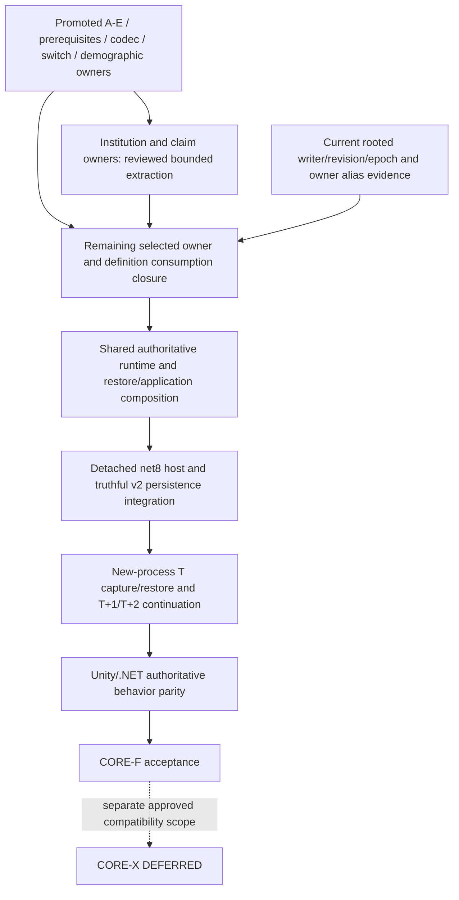

# CORE-F current owner closure and next execution package

**Architecture base:** `a20978d2b61e07a4b131afbb3971aae346511acb`.
**Execution source:** promoted `codex/core/canonical` at `b2c2c0e94c7a8dd9175a8db3fab4fb9d78dcfb2a`.
**Inspected P12 remote:** `4cc31073f0ec6ba5c718084e4cebd6e914931d5d`.
**Status:** bounded architecture/design preparation. Full CORE-F Shared Daily-v1 Application and Host remains **WAIT_DEPENDENCY**; CORE-X remains **DEFERRED**. No production migration or new checkpoint ID is introduced.

This record refreshes the [closure execution contract](CORE_F_CLOSURE_EXECUTION_CONTRACT.md) after demographic-owner promotion. Earlier demographic implementation-ready wording is historical. Current Core source, its retained implementation review and the actual promoted ref establish delivery; an older architecture checkout's executable tree is not the execution baseline.

## 1. Current canonical findings

CORE-A through E, shared Values/Owners/Persistence prerequisites, frozen P18-D codec/numeric compatibility helpers, Unity provider switch and demographic owners are promoted. The demographic review is retained in the execution repository at `docs/validation/CORE_F_DemographicOwners/IMPLEMENTATION_REVIEW.md` (code `9c1ed5e2065f2d509b61e63b39fb6c84508fd5fe`, tree `f9934338811f7272c8f7013f5bbda14e06c4a92e`). Recorded implementation results are CoreValidation **188/188 cold and warm**, Unity EditMode **3177/3177**, focused owners **17/17**, Smoke **5/5**. These are retained implementation results, not runs performed in this documentation wave.

The subsequent `fe1c5912ca31ee6bed6e22bd2694a8436000bf2a` source reconciliation is a docs-only, reviewed candidate on a demographic branch; it is not Core canonical. Its frozen graph/overlay is retained in [PostOwnerGraph](../validation/CORE_F_CurrentOwnerClosure/PostOwnerGraph/README.md) as analysis input with its original provenance. The audit found no concrete missing invalidation edge in its **24 named operation cases**. It does not establish complete writer/revision/epoch coverage. Preserving that distinction is mandatory.

Current dependency graph observations: **322** application sources, **2,923** file edges, **122** SCCs, **227** runtime-reachable and **296** restore-reachable application nodes; largest SCC **190**. There are **44** explicit Core production source links. Graph reach is declaration/file reach, not a supported-profile call graph, an assembly-compilation proof, or permission to move 296 files unchanged.

## 2. Exact selected-owner inventory and proof status

The [current family ledger](../validation/CORE_F_CurrentOwnerClosure/OWNER_FAMILY_CURRENT_LEDGER.csv) maps **89/89** family definitions to current provider blobs/witness methods, actual owner types and owner-member source paths. There are **76 Required** and **13 ExplicitlyEmpty** definitions. Required with zero rows is not ExplicitlyEmpty. The shape remains **61 + 22*N + U + P + 4*C**; fixed fixture values N=10/U=10/P=0/C=2 give 299 realized sections, whereas a dynamic N=11 fixture gives 322. Neither fixture count replaces keys, roles, aliases or dynamic cardinality rules.

The [member inventory](../validation/CORE_F_CurrentOwnerClosure/OWNER_MEMBER_ACCESS_INVENTORY.csv) contains **3,867 owner declaration rows and 916 provider declaration rows**; a shared owner's declarations can appear under several families. Each row names current source/blob/type/visibility/signature/line. The [source inputs](../validation/CORE_F_CurrentOwnerClosure/FAMILY_CURRENT_SOURCE_INPUTS.csv) and [provider witnesses](../validation/CORE_F_CurrentOwnerClosure/OWNER_PROVIDER_WITNESS_INDEX.csv) retain current source identity separately from historical test/contract anchors. All 89 owner types and census witness selectors resolve. A resolved witness is not proof of all callers or writes.

The family ledger joins the original per-family writer, revision/alias, epoch, transition, capture, restore and codec claims in `matrix_*` columns. The original [writer matrix](../validation/CORE_F_CurrentOwnerClosure/OWNER_WRITER_MATRIX.csv) is retained unchanged for provenance. Its 89 `source_path` anchors are the image contract declaration, not owner bodies; the mechanical source join includes 142 distinct files (89 application, 53 tests). Current owner-body mappings correct that limitation. Historical matrix claims must be verified against current rooted methods before being called current semantic closure.

**Complete mapped inventory is established; complete current semantic writer proof is not.** No count, source identity equality or passing 24-case overlay silently discharges the remaining owner/ingress obligations.

## 3. Authoritative reachability boundary

Exhaustive means exhaustive for the fixed supported Daily-v1 effective composition and its admitted entry points, callbacks and nested operations. It does not require proof over arbitrary callers of every public API, unsupported direct Store mutation, other profiles, or future mods.

The [public-root inventory](../validation/CORE_F_CurrentOwnerClosure/SIMULATION_RUNTIME_PUBLIC_MEMBER_ROOTS.csv) enumerates **169** public SimulationRuntime declarations: **101 methods**, 67 properties and one constructor, including its P18-D partial. Its 26 syntactic `TryBeginP12` method candidates are not 26 operations or proof that all writers are guarded. The retained contract has 24 named operation cases. Bootstrap, host/session entry, outer advance and their registered callbacks must also be traced; properties exposing mutable owners require actual selected consumer/alias classification, not a blanket read-only label.

For each supported root, follow exact receiver identity through nested operations to state change, revision effect, successful commit notification or enclosing epoch change, rejection/exception/rollback and capture invalidation. Associate the same live owner instance with provider registration, capture/export, stage factory, relation validation and post-bind recapture. Clear a read/proposal branch only after its callees and returned aliases are known. Unsupported routes are excluded by the accepted profile contract and demonstrated composition/call reach; a missing guard is not a guard.

The [15 concrete facade candidates](../validation/CORE_F_CurrentOwnerClosure/FACADE_PROFILE_CANDIDATES.csv) distinguish:

- P8-D observation/route-plan public writes with no direct P12 operation wrapper: selected exact-zero/no-producer classification, not universal hard rejection.
- PoliticalKnowledge holder/observation and PoliticalDecision public writes: Required-zero/restored-fixture owners, no registered supported Daily source producer. P12-G synthetic restored binding evidence does not introduce a normal source writer.
- P15/P16/P17 composition-specific routes and named-birth/conflict-injury paths with their actual scope/rejection evidence.
- `TesteSimulacao.TryStartExpedition`: a concrete conditional root requiring active session/system/site availability; an explicit Daily exclusion was not established in this audit. Its exact selected composition/call path remains a finite evidence task before whole-host readiness.

Population operation receipts are registered and captured but have no admitted successful receipt writer in the selected operation/configuration set. The operation expected-section sets and disabled NaturalMortality/AggregateDemography producers matter. A generic receipt API or P18-D provider does not create a Daily writer. All 11 allocator counter kinds belong to implemented P12-C root capture, not a new P12-B owner-registration requirement.

### Finite remaining proof work

Use the 89 family rows, 101 method entries, host/bootstrap/advance roots and concrete facade candidates as a finite checklist. Reuse named P12 tests and reviews where inputs and claims match. Produce rooted current source traces and owner-instance/revision/epoch joins for the admitted subset, plus explicit supported-profile exclusions for the rest. Resolve the expedition candidate and live returned-owner aliases. Add focused negative/regression evidence only for a concrete uncovered obligation. Broad unbound syntax-name matches are a diagnostic aid, not mandatory proof over unrelated APIs or a reason to accumulate micro-tests.

This is primarily missing **current semantic evidence**, coupled to source integration. It does not assert a newly demonstrated production invalidation defect. If a trace proves a concrete accepted-profile bypass, isolate that defect and its bounded fix; do not declare all existing P12 guarantees reopened.

## 4. Capture, hydration and restoration reuse

The [current protocol/source audit](../validation/CORE_F_CurrentOwnerClosure/RESTORE_PROTOCOL_AUDIT.md) records exact methods and blobs. P12-B through G are implemented in the current Unity profile. Their absence from the shared assembly is migration work, not missing production token/quiescence architecture.

| Requirement | Existing authoritative behavior | Remaining Core work / evidence |
|---|---|---|
| Export and hydration | Same-attempt F capture before C/D/E, token revalidation, immutable packages, codecs and detached exact-revision factories | Move actual source with owner dependencies; retain identical rows, ordering, roles, revisions, allocator/RNG/sequence state and source attempt. Prove .NET execution separately. |
| Relation integrity | P12-G full staged graph, exact owner aliases, person/NPC/genealogy and political/spatial/travel links, target sentinels, late vector/epoch recapture | Preserve one source and stage order; map all family target references to resulting shared owners. No raw-row export replacement. |
| Failure atomicity | Private candidate, complete checks before active-session exchange; prior live graph/slot retained on rejection | Extract Core-owned session gate and one publication; Unity retains lifecycle/path/log/asset adapters. Preserve expected-session/generation and callback/finalization behavior. |
| Quiescence | Exact Thread object plus managed ID, registered operation contexts, per-runtime advance lease, mutation epochs and full owner vector | Move existing protocol/runtime together. No second latch, global synchronization framework or independent host advance authority. |
| Completed boundary | Internal immutable runtime/context/config/calendar/profile/world/day/sequence/provenance/epoch/vector token; only fully successful positive outer advance or validated restored admission issues it | Keep token internal/ephemeral. Clear on entry/failure/staleness. Merely idle, rejected, partial, throwing or faulted advance cannot issue one. Preserve batch-final issuance. |
| Shared restore | Current P12-G private image restore: compatible header, fresh C/D/E/F owners, bindings, validation, guard, recapture, restored admission, one publication | Shared runtime/coordinator/application assembly closure is still missing. Existing Unity evidence is a baseline, never proof of detached .NET continuation. |

`ContinuationCensusProtocol.cs` has no lexical UnityEngine import, but references concrete NPC/profile types in the current compile graph. It is not an already portable leaf or independently ready extraction. The clock alone similarly cannot establish runtime admission. The source comment saying the protocol is not wired is stale; current Runtime registers and uses it, while Runtime owns token lifecycle.

Shared atomic-slot, wire and descriptor-v2 primitives already exist. Actual P12 header/image/codec/store/coordinator paths still use v1. Shared v2 integration must retain Unity v1 behavior, carry truthful host/build identity, reject incompatible input before staging, and add explicit-root injected file operations to load (current load hardcodes system operations). No second file-store algorithm or cross-host save-loading claim is authorized.

## 5. Next coherent implementation package

The [institution/claim technical design](CORE_F_INSTITUTION_CLAIM_OWNER_TECHNICAL_DESIGN.md) and [Master handoff](CORE_F_INSTITUTION_CLAIM_OWNER_MASTER_HANDOFF.md) define **seven actual source files**, three owners and **six Required families**: institutions; Office records/incumbencies/tenures; PoliticalClaim records/recognitions. PropertyContracts moves only as a pure target-type dependency. Faction/Support/PropertyOwnership/Estate and definition-bound Person/City/NPC closures remain excluded.

After independent design PASS and architecture publication, this bounded package is **READY_FOR_IMPLEMENTATION**. It consumes the promoted same-object mutation-status binding pattern. Original Unity writers, census, snapshot/codec/coordinator lifecycle remain authoritative callers; exact bridge/access changes are specified. No second writer, epoch authority, broad IVT or new public mod surface is introduced.

Two source-confirmed restored-clone losses must be corrected within this package: Office register/assign/vacate yields revision 3, whereas replay can yield 2 and reorder tenure history; Claim recognition updates/resolution can retain cardinality while increasing revision, which ordinary replay loses. Preserve ordinary/null constructor behavior; restored-only exact values, native tenure mutation order and saved revision follow the complete existing validation pass. P12 vector mismatch already rejects a bad candidate; this record claims no wrong-world publication and no executed defect test. Authentic source capture→image→P12-G restore→recapture regressions are mandatory.

The package has a complete bounded access/caller contract; readiness does not imply semantic closure for all 89 families or a runnable .NET world. Exact source files, named bridge APIs, guard binding, runtime validation, tests, rollback and hotspot ownership are in the handoff. Its 2,846 baseline source lines (comments/blank lines included) give moderate migration complexity; adapter and test edits are additional. Residual runtime work is high complexity, based on the 190-source SCC and 296 restore-reachable nodes, not a promise to move that many files or a calendar estimate.

## 6. Closure DAG, ownership and dispatch

The institution package may implement independently of remaining semantic inventory work, using isolated source ownership. Remaining definition/runtime/restore/host design work can proceed in parallel as preparation under the existing approved application contract. Actual Runtime, P12 capture/stage/registration, SDK/asmdef and canonical integration are serialized to one owner. Whole shared application/host implementation remains WAIT_DEPENDENCY until its member/type/source closure and resulting constructor interfaces are fixed. Do not dispatch a facade-only host over incomplete owners.

| Master task | Readiness | Objective exit / ownership |
|---|---|---|
| Institution/claim owner extraction and bounded restored clone preservation | READY_FOR_IMPLEMENTATION only after independent PASS and architecture publication | One package integration owner; exact seven-source compile closure, six-family writer/capture/restore parity, complete focused/full gates and independent implementation review. |
| Remaining rooted owner/writer and definition source cut | Authorized technical preparation, not whole-host implementation-ready | Current source traces for selected admitted roots, receiver/alias/commit/revision/epoch and stage joins; canonical definition nodes retain current reference identity. Domain analyses can be isolated. |
| Shared runtime/restore/application | WAIT_DEPENDENCY | Consume actual selected owner/definition closure, retain internal lifecycle and one authority; one serialized Runtime/P12 integration owner. Existing application design is reused. |
| Detached net8 host, v2 persistence and continuation/parity | WAIT_DEPENDENCY on shared application/source integration | Fixed same effective input fixture and truthful host identity; actual new-process save/load/advance evidence and finite rejection suite. Host design can prepare concurrently; production integration follows dependencies. |

Final CORE-F acceptance remains the finite eight-part contract in the [closure execution contract](CORE_F_CLOSURE_EXECUTION_CONTRACT.md#5-finite-final-core-f-acceptance): actual shared genesis, legitimate completed token, capture and process termination, detached strict restore without source objects/genesis/RNG effects, T/T+1/T+2 and later round trips, cross-host behavioral comparison, bounded negative/atomicity obligations, and complete two-host validation/evidence. Retain original case identities; do not replace them with counts or endless isolated tests.

No product decision is open. No P12 profile/CORE-X expansion, closed-phase reopening, unrelated numbered-phase gate, production change or active implementation checkout modification follows from this record. Implementation candidates require current Core applicability, independent exact-tip review, accurate Core State and separate normal promotion.