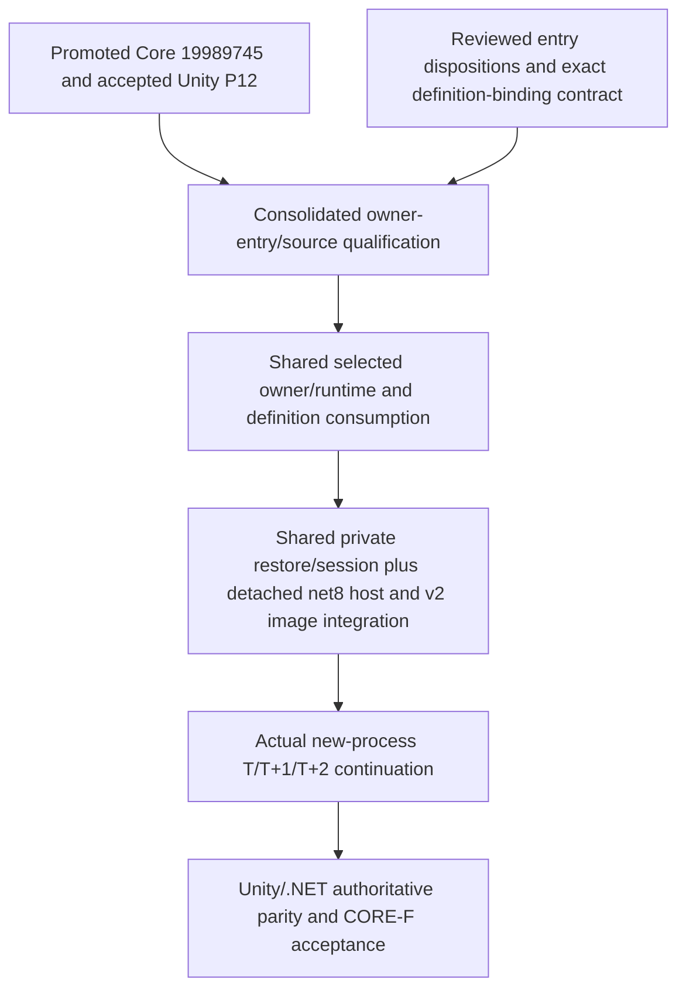

# CORE-F selected-owner entry contract

Architecture base: `797eb02f06fc5ca759a7e47283589d97a5efe73d`.
Execution source: `1998974515b6357c308d861fb608f2db5071a63a`.
Evidence input: `9ff22b218cad26069371c871c84f3c37db4e0f1d`, independently reviewed source/access evidence candidate, **not promoted to Core**. Its 1,660 source references and 42,625 syntax/semantic reference sites are evidence inputs, not complete behavioral closure. No production implementation is made by this contract.

## Decision

A Required owner does not need a newly invented normal writer to enter the shared Daily-v1 source cut. Required is the existing schema/composition role: the owner, provider, schema, exact values, revision and aliases must be represented, including at zero records. Writer reachability is a separate dimension. Replace the former unconditional “writer/epoch for every family” entry condition with the dispositions and obligations below.

This does not drop an owner, admit an unsupported state or weaken capture. Retain all 89 definitions (76 Required, 13 ExplicitlyEmpty), dynamic keys and `61 + 22*N + U + P + 4*C` shape. No normal writer, generic seed API, save override, new synchronization authority, loader, or profile is authorized.

## Entry policy

Every family requires one current source owner/type/member, creation/injection path, exact installed instance/provider identity, all admitted ingresses, capture encoder, staged factory/hydrator, relation validators and case identity. Classify state admission and mutation reachability independently:

| Classification | Required proof |
|---|---|
| Required with supported runtime writes | Trace all selected admitted writers and nested effects to the exact owner, successful revision/commit/epoch behavior, rejection/rollback, capture and restored target. Preserve existing callbacks, contexts, one guard and lease. |
| Required with inherited/preserved state and no normal selected writer | Preserve all states that the current accepted validators actually admit. Prove owner creation/injection, source capture, exact staged rows/revisions/aliases and graph admission. Trace selected operations to conservation of this owner or the existing declared effect. A new producer or artificial epoch increment is not required. |
| Required with a current profile-specific value restriction | Keep the Required role and its real owner/codec. Retain the existing empty-only codec, missing-root rejection or explicit source/target guard, with source-linked qualification. This is not a permanent world-domain zero invariant and not a conversion to ExplicitlyEmpty. |
| ExplicitlyEmpty in this profile | Preserve the existing explicit role and cardinality restriction at registration, quiescence/capture and restore. Preserve schema, owner identity and exact revision as prescribed; zero content does not by itself require revision zero. |
| No currently reachable selected producer | Document the supported root set and the actual guards/composition prerequisites that exclude writes. Public visibility or a generic system method is not selected-profile admission. Retain read, capture and hydration capabilities; do not erase them. |
| Unsupported future behavior | Keep it unadmitted under existing boundaries. Record the capability needed before enabling it; do not make future producers/profile expansion prerequisites for reproducing today's accepted profile. |

Initial zero witnesses are scoped to their exact authored fixture and admission boundary. They are not all-time conservation proofs, writer coverage, or universal restore restrictions. A codec capable of nonempty rows is not evidence that a complete graph containing those rows is admitted. Conversely, lack of a normal writer does not imply that valid inherited/restored values can be discarded.

Supported reachability starts at the fixed selected composition, bootstrap/finalization, admitted runtime/host commands, ordinary advance and registered callbacks, and accepted private restore construction. It includes every nested effect on installed owner instances. It excludes arbitrary public Store mutation, detached objects supplied by external callers, other profiles, and future mods. Returned mutable aliases must be classified against actual supported consumers; they cannot be cleared as read-only by name. No security claim against arbitrary code follows.

Completed-boundary admission remains unchanged: only a fully successful positive outer advance or the existing validated restored-boundary path can issue the internal ephemeral token. Failed/partial/throwing/faulted/idle states cannot mint eligibility. Preserve runtime/context/config/calendar/profile/WorldId/day/sequence/provenance/epoch/vector identity; use authentic same-attempt E/F capture and G staging, binding, late recapture and one publication. Do not turn an owner-disposition row into a token or a second admission authority.

## All eighteen Required no-normal-writer families

The [18-family disposition ledger](CORE_F_OWNER_DISPOSITIONS.csv) retains exact family names and source anchors. All eighteen remain Required.

| Families | Current disposition |
|---|---|
| `p12e.armed-force.forces`, `.contingents`, `.relevant-person-references` | Initially zero; preserve admissible inherited state through existing military snapshots/staging and one aliased ArmedForceStore. No P16 producer is added. |
| `p12e.contingent-manpower.states` | Initially zero; preserve admissible manpower state/revision and contingent references. |
| `p12e.armed-force-spatial.positions` | Initially zero; preserve admitted force/spatial references and exact revision. |
| `p12e.conflicts`, `p12e.wars`, `p12e.battles` | Initially zero; preserve admitted records/revisions and Force→Conflict→War→Battle graph dependencies. Existing staging/cloning is not constrained to zero by G's military sentinels. New .NET execution proof remains required. |
| `p12f.political-knowledge.holders`, `p12f.political-decisions.records` | Initially zero on normal bootstrap; existing approved synthetic restored-source evidence proves populated authentic E/F capture and G binding/continuation. Preserve those values and checks. It creates no ordinary Daily political writer or simulated prehistory. |
| `p12f.explorable-site-knowledge/` | Required; populated codec exists, but valid selected graph has no registered site roots. Preserve current referential admission/rejection and source values only when the complete current validator permits them. No site producer/profile expansion. |
| `p12f.local-topology-knowledge.places/`, `.connections/` | Required; current P12-D codec is explicitly empty-only with zero revision and shared owner. Preserve that codec restriction. Initial-zero evidence alone is not its justification. Populated topology needs a separately admitted capability, outside this extraction. |
| `p12f.adventure-intel.opposition/`, `.notable-items/`, `.common-resources/`, `.access/` | Required; populated codecs exist, but site/local-place roots needed by those facts are absent from the accepted graph. Preserve codec and whole-graph checks; no unsupported population of those roots. |
| `p12f.expeditions` | Required; populated F snapshot/codec/staging exists, but current G explicitly rejects nonempty source capture and restored targets. Preserve that existing guard and owner payload/revision/schema. “Preserve-only” does not mean populated expeditions are currently supported. |

### Expedition and site reachability: actual exclusion before publication

A real general writer exists: `TesteSimulacao.TryStartExpedition` → `ExpeditionSystem.TryStartExpedition` → reservation/commit in ExpeditionStore; autonomy also calls it. It is not an admitted selected writer merely because those methods are public.

Ordinary P9 configuration validation can accept site rows, but the selected Daily composition subsequently registers site/local-place/local-connection/notable-item identity owners and the ExplorableSiteStore as **ExplicitlyEmpty** in `P12RuntimeIdentitySpatialCensus.TryRegisterP12RuntimeIdentitySpatialCensusOwners`. Runtime's initial `ContinuationCensusProtocol.TryAssessOwnerSectionInventory` validates those roles; a nonzero witness fails and Runtime discards its census protocol. `TesteSimulacao` then cannot bind the P12 economy adapter or begin bootstrap-publication scope, and never publishes a healthy selected world. P10-A/B rejection is an additional separate boundary, not the proof for ordinary P9 sites.

`ExpeditionSystem.TryPrepareStart` requires the exact target object already registered in that site's store, plus valid context, route and performer knowledge. A foreign target object cannot bypass the selected empty-store invariant. Selected restore retains the explicit-empty site/identity census. Thus the general expedition writer cannot meet its prerequisites in a healthy admitted selected graph; arbitrary direct store insertion is outside the supported root set. This proof is profile-specific, not a permanent Expedition domain law.

Independently, `TryValidateDailyV1ExpeditionExactZero` is called before authentic source capture and during staged/image target admission. It checks the live owner and Required vector row, matching schema/revision/identity and cardinality zero. Keep it unchanged. Enabling populated expeditions would need an admitted site/topology/root graph, writer/epoch integration and complete populated G capture/restore/continuation proof. That is future behavior, not a missing prerequisite to host the existing profile faithfully.

## Source and definition cut

Reuse [the shared application/runtime design](CORE_F_RUNTIME_RESTORE_INTEGRATION_DESIGN.md) §§11–14: one Simulation.Core assembly owns semantic owners, Runtime, contexts/guard/lease/token, capture/staging/relations/session/publication. Keep internals in that assembly, existing official Core bridges where still needed, and the reviewed DailyV1Application host surface. No IVT, engine stubs, copied algorithms or new public Store/mod API.

The [definition-binding design](CORE_F_DEFINITION_BINDING_TECHNICAL_DESIGN.md) fixes City/NPC/action/item/market consumption of the single DailyV1EffectiveDefinitions graph, rather than merely computing its fingerprint. Keep Unity asset/default/fake-null conversion at the boundary; runtime and restored owners consume canonical node references. Preserve existing ReferenceEquals item/action semantics and typed-family ID resolution. Private transient owner lists are rebuilt by bootstrap; they are not authored Unity serialization inputs. Keep authoring asset schemas/GUIDs and explicit P12 stable-ID codecs.

The evidence candidate's 315 application inputs / 53 existing Core inputs, 220 runtime / 289 restore files and 67 split files are a finite source inventory, not a wholesale move order. Every family-to-member/constructor/operation/capture/hydrator row and every relevant caller/target group must receive an explicit destination. Group repeated rows without losing coverage of the original 42,625 reference-site records. A policy category or source path alone does not prove its implementation or receiver alias. Existing numeric helpers cover the inspected Mathf overloads; all five params-Min sites are three-int calls and map to the existing three-int helper. Validate source-specific host/null/numeric behavior; do not silently substitute System.Math for Unity semantics.

## Finite delivery plan and readiness

The [qualification Master handoff](CORE_F_OWNER_ENTRY_QUALIFICATION_MASTER_HANDOFF.md) is the next bounded **test/evidence implementation package**, READY_FOR_IMPLEMENTATION only after independent PASS and architecture publication. It changes no production simulation capability and creates no checkpoint ID. It closes one finite ledger/test package rather than requiring a writer for each empty owner or accumulating isolated tests indefinitely.

The shared Runtime/Application production package remains WAIT_DEPENDENCY until that package closes the current source/member/access joins and resulting interfaces. The definition-binding technical design can be prepared concurrently; authoring-side fixture/case mapping is parallel safe. Runtime, persistence, project/asmdef and canonical integrations remain serialized. Once qualification exposes a concrete source defect, resolve only that demonstrated defect under the existing contract; a new gameplay producer, generalized pipeline or compatibility expansion requires its own scope.

No genuine product decision remains. P12 stays closed within its accepted Unity same-build/current-host contract; this decision neither proves .NET continuation nor expands P12 or CORE-X. Existing unrelated implementation-ready phases remain independent.