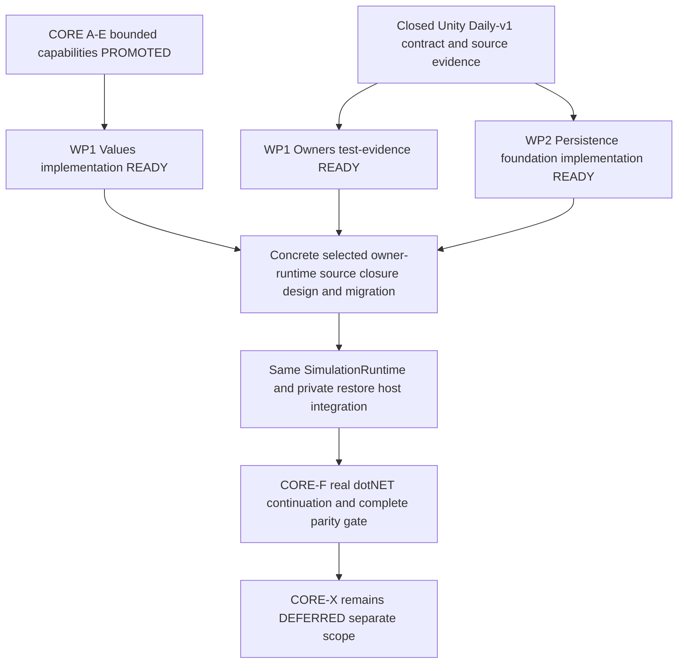

# CORE-F — executable prerequisite work / Master handoffs

**Date:** 2026-10-14. **Production base:** `codex/core/canonical`
`8ea3b47e9ab1be9ab3fe6261a73dc33fece8cd8f`.
**Architecture base:** `7166ed088483c69d37300b4f12528ebb4b27be84`.
**Parent design:** [Daily-v1 host technical design](../design/CORE_F_DAILY_V1_HOST_TECHNICAL_DESIGN.md),
exact production blob imported from that base. The user confirms independent parent
design PASS. Its old header still describes its submission; this reviewed handoff
supersedes that status only. Parent CORE-F implementation remains WAIT_DEPENDENCY.
**Scope:** three substantial work packages inside existing CORE-F WP1/WP2, not new
checkpoint IDs, phases or product capabilities. No runtime code is implemented here.
**Review:** [independent record](CORE_F_PREREQUISITE_REVIEW.md).
**Master implementation target:** `codex/core/canonical`, using isolated candidates
and current-base dependency refresh. No numbered-phase canonical is moved.

## 1. Decision, missing work and ready set

A–E have their bounded promotions. Fourteen Core runtime sources and the existing
125-case .NET suite do not include the selected live owner graph or restore host.
The current 89-family inventory and 39-asset blobs were rechecked against 8ea3b47e;
those identities are not proof of effective values or complete writer coverage.
The accepted Unity P12 contract is closed and remains valid. The task is to create
portable definitions and persistence code and migration-specific evidence, not
reopen P12 or add writers to make tests possible.

| Package within existing CORE-F | Precise missing implementation/evidence | Reviewed dispatch disposition |
|---|---|---|
| WP1-Values: effective definition/configuration parity | Pure value graph, asset conversion, shared effective resolver, exact independent value/fingerprint comparison; source YAML is insufficient. | READY_FOR_IMPLEMENTATION after this design PASS/promotion. |
| WP1-Owners: live binding and supported writer closure | Current-source matrix joining every census family/live owner and admitted ingress to revisions/epoch notifications/export/hydration, with executable cumulative witnesses. Existing Unity code/evidence is reused as baseline. | READY_FOR_IMPLEMENTATION as a test/evidence package; no speculative production capability. |
| WP2-Persistence: portable descriptor and atomic storage foundation | Shared BCL v1 descriptor/wire, exact approved typed v2 descriptor/dispatch, atomic byte slot used by existing Unity P12 wrapper and SDK tests. | READY_FOR_IMPLEMENTATION after this design PASS/promotion; no owner/image/runtime host claim. |

These dispositions apply after independent review and architecture promotion,
not before. They do not promote CORE-F itself to implementation-ready.
All three are ordinary technical work under accepted semantics. No product or
architecture decision is missing. Finding a concrete unsupported source edge or
behavior mismatch requires a bounded technical correction/review, not a routine
request for human approval or a new general synchronization framework.

## 2. WP1-Values — exact implementation handoff

### 2.1 Outcome and boundaries

Deliver one immutable, engine-free effective Daily-v1 definition graph and a Unity
conversion adapter, with an independently constructed fixed .NET fixture and exact
value/identity parity. Reuse the current configuration precedence/validation rules
by moving their actual pure implementation, not writing a second resolver.
No owner, NpcRuntime/CityRuntime, daily loop, hydration or WorldId publication moves
in this package. No public content language, JSON/YAML loader, registry framework,
mod API or additional gameplay profile is introduced.

Move these five whole existing BCL sources and .meta GUIDs from
`Assets/_Project/Scripts/Configuration/` to
`Packages/com.simulation.core/Runtime/Configuration/`, preserving their names,
visibility, constructors, fallback/validation behavior and namespace:
SimulationConfigurationTypes.cs, SimulationConfigurationDefaults.cs,
SimulationConfigurationResolver.cs, SimulationConfigurationValidator.cs,
SimulationConfigurationValidationResult.cs. Their dependency closure is BCL and
their own types. Leave SimulationCompositionValidator in Unity; it consumes
actual domain/runtime components, not just value resolution. No new visibility
bridge is needed for the five-file closure: the result/resolver internal constructors
have their callers inside that set; existing public effective-value constructors
used by P12 remain public. Verify actual closure by explicit SDK build.

Add a bounded value implementation under `Runtime/Definitions/`:

- `DailyV1EffectiveDefinitions.cs`: immutable copied root values; typed City, Item,
  Npc, Job, Action, Status records; nested row values; effective configuration,
  calendar values, seed/profile/geography inputs. Use existing semantic definition
  ID strings in typed fields/maps. Lists preserve multiplicity, null entries where
  accepted, and source order. Lookup maps use ordinal IDs. No runtime IDs are minted.
- `DailyV1DefinitionIdentity.cs`: one canonical implementation of the current P9
  fingerprint record construction/Pack/Add/AddOrdered and hash, and the pure
  provider/calendar fingerprint portions used by P12. Move actual rule bodies from
  SimulationGenesisPipeline/P12ACompatibilityDescriptorFactory; their old methods
  become adapters calling the shared implementation with copied value inputs.
- `DailyV1ContentProjection.cs`: private-composition immutable compatibility values
  for the current P12 serialized catalog, and its single canonical encoder.
  This is an in-memory compatibility projection, not a new durable schema/loader.

Names above fix roles and source ownership; ordinary constructor/file partition
choices may vary without changing the contract. Add explicit SDK Compile links;
retain the existing single noEngineReferences Core asmdef, netstandard2.1/C#9,
pinned SDK9.0.315/net8 proof host and locked test dependencies.

Add `Assets/_Project/Scripts/CoreAdapters/DailyV1DefinitionAdapter.cs` to resolve
Unity objects into those pure values. ScriptableObject classes, getters, fields,
attributes and .meta remain in their existing source paths. Do not move their enums
or mixed authoring classes to satisfy this package. Core values represent an enum
by its underlying integer plus the canonical existing symbolic spelling where the
identity encoder needs Enum.ToString; the adapter preserves unknown/combined values
and current validation results rather than imposing Enum.IsDefined universally.
The same semantic enum value is used by all consumers; this projection creates no
new product enum or parallel runtime authority.

### 2.2 Complete member/reference contract

The [source member map](CORE_F_SELECTED_VALUE_MEMBERS.csv) identifies **164** fields
in the selected seven asset types and their relevant inline value classes, including
calendar, commercial settings and log settings. Every record names its declaring
type, field/type/initializer, source line and production blob. It is the exhaustive
source-member baseline for this package, not evidence of resolved Unity values.
The implementation adds a mapping from every row to its effective value accessor
and/or compatibility projection accessor. No silent dropped field or unknown row.

Top-level asset types are SimulationConfigData, CityData, ItemData, NpcData,
NpcJobData, NpcActionData and NpcStatusData. Inline rows are those in the CSV:
NpcSimulationConfig/initial inventory, City market/production/connections/liquidity/
consumption, default actions, status weights, crime settings, trade preferences,
site/warrant/directive configuration, capability value/modifier slots and settings.
For empty unselected reference families, retain their typed null/empty compatibility
shape; do not instantiate new Trait/CapabilityAttribute/Site/Topology/Organization
assets or infer gameplay support from a type existing in a field declaration.

Build definition tables once by stable type/ID, then resolve typed ID links. Reciprocal
City connections are valid graph edges; do not reject cycles or recursively clone
an entire connected City graph per reference. Preserve source-order lists used by
runtime, and apply only each existing fingerprint's specific sorting rules when
building its identity records. Never globally sort/deduplicate semantic lists to
make parity pass. Multiple references to the same asset retain one canonical node;
different assets claiming the same type/DefinitionId retain existing ambiguity
rejection. No IDs from Unity InstanceID, GUID path, display name or registration order.

The adapter takes resolved root/config/calendar inputs at the same bootstrap
resolution point as current code. It calls the moved resolver with the existing
preset/world/content precedence; it does not create Core defaults from YAML text.
Pin the selected fixture's actual Unity-resolved defaults, including omitted fields,
nullable nested objects and lazy getters. Snapshot policy inputs before publication;
mutating an authoring asset afterward must not mutate a copied Core value graph.
No world is initialized merely to compare definitions.

### 2.3 Preserve two distinct existing identity paths

P9 CreateFingerprint hashes curated configuration/effective records. P12
FingerprintContentCatalog hashes every reachable serialized field, including
presentation/config fields and null/list shape. They must remain distinct.
Equal normalized effective values alone do not prove content fingerprint equality.

The Core content projection retains each existing serialized type token, declaring
type/field token, tag, numeric bit pattern, enum spelling, reference key and list
order/nullness. Legacy CLR generic full names may embed assembly identities; the
Unity adapter records those exact tokens as compatibility data and the fixed .NET
fixture uses that recorded token table. The shared encoder never derives those
tokens from a different CoreCLR generic Type.FullName. Descriptor-v2 host/build
identity separately remains truthful; legacy content tokens are not host identity.
The projection is restricted to the selected schema/member/reference graph; it
must not accept arbitrary new type tokens or executable/reflection metadata as a
content extension API.

Retain current ordinal catalog-key ordering, reference cycle termination and
same-reference/duplicate-ID checks, byte/type tags, strict UTF-8 length framing,
field sorting by declaring type then field name, null versus empty, scalar encoding,
65,536-asset/64MiB/depth64 bounds, and all existing P9 canonical record rules.
One shared encoder owns the byte-writing/hash rule. Unity remains responsible for
reflection/serialized-field selection and mapping; no second encoder remains in
the factory. Baseline captured field/token/byte vectors are test data, not a second
runtime fingerprint algorithm. P12AWire and P9 Pack are separate existing framing
contracts; do not conflate them.

Keep descriptor-v1 wire layout/parse/write semantics unchanged. No save conversion
or masked build/MVID identity. New assembly moves produce a new build; save/load
within that extracted Unity build must work and incompatible older builds must
fail closed. This package does not claim a .NET image or continuation host.

### 2.4 Validation and closure

Before moving encoder/resolver code, add characterization tests to capture the
unchanged Unity production root's complete ordered effective values, P9 canonical
records/hash, P12 catalog bytes/hash and provider/calendar/P8/P9 identity values.
Use the dedicated Simulation-DailyV1.asset and all 39 reachable assets from the
existing authored inventory. Record actual resolution order and exact Unity
container/type tokens; do not fabricate a baseline by serializing the new DTOs.
Compare semantic fields and bit patterns, not only a whole hash.

Build the fixed .NET fixture as reviewed C# constructor/data-only vectors under
tests/Simulation.Core.Tests/Fixtures, including all mapped fields and raw-compatibility
shape/tokens, with no runtime YAML reader or Unity dependency. Compare against the
retained Unity vectors independently. A generated fixture is allowed only with
its generator/input identity recorded and a complete field-by-field source review;
copying one digest or opaque serialized snapshot is not effective-value proof.

Shared tests cover current resolver precedence/errors/defaults, exact values,
ordered references, reciprocal City links, reused/missing/duplicate identities,
null/empty/lazy getter effects, copied immutability, enum spellings/numeric bits,
current invalid cases and fingerprint-changing edits. Unselected populated content
uses current profile rejection; no new universal constraints on valid authoring.
Keep all current configuration/generation/P12 tests and case identities. Core cold/
warm plus unchanged Lab; Unity focused configuration/bootstrap/genesis/content/
compatibility and persisted continuation, ALL EditMode and official Smoke. Run
existing LongRun because production configuration/fingerprint paths are refactored;
no shortened horizon. No .NET result substitutes for Unity serialization/defaults.

Completion is the five-file engine-free configuration closure plus a complete
164-field mapping, identical independently constructed Unity/.NET values and the
existing identity byte/hash outputs, actual Unity production fingerprint adapters
using shared encoders, all gates and exact-tip independent implementation review.
Do not require full owner/runtime migration to close this prerequisite.

## 3. WP1-Owners — exact live binding / writer evidence handoff

### 3.1 Objective and authorized implementation

Deliver one cumulative, executable selected-profile migration baseline and a
source-linked closure matrix. This is test/harness and evidence implementation
using existing production capabilities. It neither redesigns P12 admission nor
adds a new owner registry, epoch, operation authority or generic reflection API.
The work may start immediately, independently of Values/Persistence production code.

Own new `Assets/_Project/Tests/EditMode/Editor/Core/CoreFDailyV1OwnerClosureTests.cs`
and one test-only helper/vector source beside it, plus
`docs/validation/CORE_F_OwnerClosure/OWNER_WRITER_MATRIX.csv`, a finite case map,
validation record and complete result package. Extend/reuse existing bootstrap,
P12-G graph/vector tests and helpers instead of copying their fixture logic.
Production owner/runtime changes are excluded from this evidence slice. A revealed
supported-route defect is a concrete follow-on correction under the existing
contract, with source counterexample and bounded design/review; no blanket fix
permission is implied and no missing route is silently relabeled unsupported.

Use the exact Daily-v1 bootstrap/current P12 session. The immutable source boundary
is `ContinuationCensusProtocol.TryCaptureQuiescentOwnerSectionSnapshot`, yielding
section snapshots plus the same traversal's mutation epoch; feed those snapshots
to P12ADailyV1Census.TryCreate. Runtime's internal TryGetCompletedDailyCaptureToken /
TryValidateCompletedDailyCaptureToken prove capture eligibility. Existing Unity
Editor tests already have the narrow Assembly-CSharp-Editor access and selected
reflection helpers. Use those test-only helpers to obtain runtime's private
npcRosterCensusProtocol/installed owners when needed. Do not widen production
visibility or add a friend grant to Simulation.Core just for this fixture.

### 3.2 Finite reachability and complete matrix

Join every row of the existing 89-family CSV to current 8ea3b47e source. The
accepted roots are the dedicated Unity Start/Simulate/Update advance route, the
owned clock and supported SimulationRuntime facades plus their actual composed
callbacks/transactions. Public method visibility alone is not admitted ingress.
Follow current root->operation->commit->notification paths, including nested
commits, rollback/compensation, callbacks and dynamic roster changes. Reuse the
closed P12 reachability/closure records and current P12-G matrix, recording their
code/input applicability; old 23-operation/275-section samples are historical.

Current conditional source registration is 24 operations when the selected solo
and group travel services are composed. Derive the exact ID set from Runtime's
InitializeNpcRosterCensusProtocol and TryRegisterP12PopulationLifecycleOperations
and compare to the live sealed inventory. A count alone is insufficient. Reconcile
all actual supported roots, even those whose ordinary daily loop has no automatic
caller (for example institution/faction/property supported facades).

Each matrix row (many-to-many rows allowed; not one test per row) records:

- Section family/key/schema/role and key/cardinality source; actual provider and
  installed owner identity/access path, including required-zero and exact-empty.
- Retained fields, authoritative local revision source and which sibling views
  alias the same instance; immutable snapshot/codec/staged hydrator/target bindings.
- Supported root and exact source commit/callback with blob/line identity;
  enclosing operation, actual changed-section batch/reservation, local revision
  progression, protocol notification method and expected epoch accounting.
- Direct and nested commit behavior, no-op/rejection, compensation and fault
  dispositions; evidence test identity or retained applicable source-backed proof.
- Dynamic family creation/removal/rebinding rules and relationships to other owners;
  exact-empty/no-writer/synthetic-restore-only classifications with source reason.

Every family and admitted root must have a justified disposition; zero Unknown
or unaccounted supported writers is the exit criterion. Required owners with no
ordinary producer, such as the accepted synthetic political binding, remain
Required and use their existing restore evidence. Do not add political/military/
Expedition producers, arbitrary retained-alias callers or external WorldCommand
queues to satisfy this matrix. Source proof and closed P12-G cases determine the
finite set; no proof over arbitrary future external callers is requested.

### 3.3 Executable scenarios and exact epoch semantics

Compare the full live witness vector before/after supported operations and after
at least one genuine positive completed advance. Assert exact semantic key sets,
owner ReferenceEquals equivalence before alias-label conversion, schema/roles,
cardinality/revision values, and the complete formula `61+22*N+U+P+4*C`.
Exercise supported NPC registration/unregistration and Person registration/
materialization/residence transitions using current APIs; at least one evolved
roster vector must be captured. Do not invent a City membership producer if the
selected profile has none. Reuse current Person/Genealogy and staged populated
binding fixtures under their existing limits.

One shared data-driven fixture covers distinct commit protocols: a multi-section
batch, multiple committed leaf notifications during one admitted operation,
reserved composite lifecycle, dynamic roster reconciliation, a pure read/rejection,
compensation/partial throw/fault, and target guard binding followed by recapture.
Map every root to one of those verified protocols or its distinct retained test.
No 89-family or 24-name micro-test campaign. Add a case only for an uncovered
supported protocol or independently identified current-source counterexample.

Critically, scope nesting does NOT universally coalesce epochs. Actual protocol
NotifyCommittedMutations validates the entire named batch then increments once
per successful notification call. An operation may notify more than once. Reserved
composite paths have their own TryReserveMutationEpochCapacity /
TryCompleteMutationEpochReservation / TryNotifyReservedCommittedMutations rules.
Pin expected deltas per source path; never impose one epoch per AdvanceDay or per
outer operation. Compensation can commit revision/epoch facts even when the final
business attempt fails; preserve actual retained state, notifications and fault
rules instead of asserting all failures are state-free. Only rejected paths that
commit nothing must preserve state/revisions/epoch. Unnotified drift must invalidate
capture/fault as current code specifies, not be silently accepted as a new baseline.

Quiescence requires the bound owner thread, sealed complete provider/operation
inventory, no active operation/reservation/lease and a coherent unchanged owner
vector/epoch. No operation-busy aggregate or CurrentDay read is a completed-boundary
proof. Capture the token from successful positive outer advance, prove stale
invalidation on supported mutations, then refresh by the next successful advance.
Negative tests cover wrong thread, in-flight/partial/throwing/faulted advances,
zero advance, stale owner/epoch, and no false live token from bootstrap/idle reads.
The accepted P12-G restored route admits only a private validated graph with saved
positive sequence/day/WorldId and freshly recaptured vector/epoch, with explicit
RestoredContinuation provenance; test it using the real coordinator, not a token
constructor or custom hydrator. Restore is not a newly simulated advance.

### 3.4 Validation and usable result

Run focused cumulative Unity owner/writer tests, affected RuntimeAdmission and
BootstrapComposition/P12 capture/restore suites, ALL EditMode and official Smoke.
No production daily logic is changed by this package; current LongRun results may
be reused only with exact input applicability. If harness/fixture work changes a
causal integration input, run its affected existing LongRun gate. Do not run an
unrelated full long-horizon campaign solely to populate the matrix.

The currently portable .NET Core/Lab regression can be reused with proven unchanged
inputs; this Unity integration package cannot run the live graph in dotnet test
before extraction. Record that limitation explicitly. Its detached pure case/row
values and mapping become later .NET comparison inputs, not .NET execution evidence.
After any owner/assembly migration, re-execute affected witnesses in both actual
hosts; baseline Unity evidence alone cannot satisfy the final F parity gate.

Completion is all 89 family and current ingress dispositions source-linked, live
provider/owner alias and dynamic membership witnesses complete, each distinct
commit protocol covered, token/quiescence assertions using existing authorities,
full result access/input identity and independent exact-tip review. It closes this
migration evidence prerequisite only. A failed matrix row identifies the precise
remaining capability; it does not reopen or silently weaken closed P12.

## 4. WP2-Persistence — exact portable compatibility/storage handoff

### 4.1 Coherent scope and exact source closure

Deliver a reusable engine-free descriptor/wire and atomic storage foundation,
consumed by the existing Unity P12 pipeline and validated by dotnet test. This is
one source extraction/integration package, not separate micro-checkpoints for each
helper. No full image, causal-root payload, census, owner codec, SimulationRuntime,
P12 session, genesis or restore coordinator is admitted to Core by this package.
Those types form the remaining real owner/runtime closure.

| Source at 8ea3b47e | Core/Unity treatment |
|---|---|
| P12ACompatibilityDescriptor in Assets/_Project/Scripts/P12AContinuationImage.cs | Move the whole existing v1 value/constructor/parser/writer/hash/mismatch implementation to Runtime/Persistence/P12ACompatibilityDescriptor.cs. Make only this type, its existing constructor and externally consumed value/parser/match members public for composition. Preserve global name, exact values, cloning and validation; no mutable owner surface. |
| P12AResultCode in the same mixed file | Move this data-only enum, unchanged order/implicit numeric values, to Runtime/Persistence/ContinuationWire.cs with public visibility. P12AResult stays internal in Unity. |
| P12AWire and P12ALimitException in that file | Move the actual string framing implementation to public static Core ContinuationWire; keep P12ALimitException as the same global publicly constructible shared exception type. Retain internal Unity P12AWire as a forwarding adapter for all five existing members. Utf8 stays an internal readonly strict encoding instance; Core exposes a fresh strict UTF8 encoding factory rather than publishing a mutable global Encoding object. No duplicated framing algorithm. |
| Six limits and BytesEqual in Assets/_Project/Scripts/P12AContinuationCodec.cs | Move exact numeric limits and equality loop to Core ContinuationWire (or adjacent ContinuationLimits). Existing codec MaxFrameBytes/MaxHeaderBytes/MaxSections/MaxSectionBytes/MaxStringBytes/MaxRows remain constant aliases; BytesEqual forwards to the single shared loop. Descriptor/wire use Core limits, never reference Assembly-CSharp. |
| Approved host design §4.3 typed v2 variant | Implement its pure immutable values/parser/canonical writer/admission policy in Runtime/Persistence/ContinuationDescriptorV2.cs, with no new schema choices. Current Unity factory remains host-specific; v1-only admission integration is detailed below. |
| Atomic byte operations in Assets/_Project/Scripts/P12AContinuationStore.cs | Move actual IO algorithms into Runtime/Persistence/AtomicFileSlot.cs. Keep existing P12 wrapper/internal signatures, slot policy, result mapping and Application.persistentDataPath convenience methods in Unity; wrapper delegates all inspect/read/write operations. No second byte-store implementation. |

Four explicit Core production Compile links suffice with combined roles above;
ordinary file splits within this exact type closure are allowed. Keep asmdef,
framework/toolchain, namespaces and assembly direction. The two original mixed
Unity source files retain their .meta; new split files get new GUIDs. Do not move
the old mixed-file meta with only one of its many types or leave duplicate types.
No P12AContinuationHeader/Image/OwnerSection/Manifest/CensusSnapshot public bridge,
blanket InternalsVisibleTo or reference back to Unity is authorized.

V1 descriptor's actual dependencies are BCL plus strict framing, byte equality and
header/string limits; its existing calls into P12AContinuationCodec become Core
helper calls. Its original enum-valued mismatch function is why the data result enum
moves. All six current limits retain exact values: frame128MiB, header64KiB,
4096 sections, section16MiB, string1MiB, 1,000,000 rows. These are existing rules,
not new tolerance or format limits. Owner-codec references remain constant aliases.

### 4.2 Typed descriptor v2 and Unity integration

The exact schema/normalization/mismatch contract is the imported parent design
§4.3; do not invent an alternate record. It fixes discriminator -2, raw P12ACDV2,
version2/reserved0, HostKind1 (.NET)/2 (recognized foreign Unity), typed runtime/OS/
architecture/target identity, sorted assembly(name, four-component version, MVID)
tuples, numeric profile and the same semantic configuration/content/provider/
calendar/P8/P9 fingerprints. Retain exact 26-field order, strict string framing,
mandatory values, 1..4096 assemblies, limits and canonical re-encode equality.
No environment discovery or v2 host-support claim is made by the pure values.

Define immutable `P12ACompatibilityDescriptorV2` with the parent-design scalar
properties and copied assembly tuples, public constructor/data members and
TryReadCanonical returning P12AResultCode; private helpers implement normalization/
canonical equality exactly once. Define a shared descriptor admission function
that accepts bytes, the expected typed host kind and that host's expected descriptor
(v1 Unity or v2 .NET); it distinguishes parse failure, unsupported schema, foreign
host, build/runtime mismatch and content/configuration mismatch as specified.
Its inputs/outputs are descriptor values/bytes and result codes, never a runtime
or owner. No field gets a fake Unity version/platform/build GUID on .NET.

At first Int32 -2, never fall back to v1. Structurally malformed/truncated magic or
encoding is CorruptOrTruncated; unknown format/reserved/host kind is UnsupportedSchema.
After structurally valid parsing, the v1-only Unity policy rejects every v2 with
UnsupportedSchema before any owner staging; the .NET policy rejects valid v1 or
v2 HostKind2 with IncompatibleBuildOrRuntime. Valid v2 HostKind1 uses the exact
parent runtime/content mismatch categories. Structural decoding solely to classify
rejection does not admit another host/profile. Preserve v1 bytes, parse/writer and
result behavior for existing v1 inputs. Tests bind these classifications explicitly.

Integrate that classification into the existing Unity codec ReadHeader at the point
it reads compatibility bytes; continue its unchanged v1 expected-descriptor checks
for v1 input. The current codec otherwise maps unknown descriptor bytes to generic
corruption, so a standalone v2 helper without this negative integration is incomplete.
No outer envelope1.0, owner row/section or descriptor-v1 schema changes.

Actual RuntimeInformation/Environment/TargetFrameworkAttribute discovery and the
complete real runtime/owner assembly-anchor manifest belong to the later net8 host
composition. They cannot be truthfully completed before those assemblies exist.
Core v2 takes typed supplied values; unit vectors may be synthetic and labeled as
such. Do not fake a current .NET world descriptor or claim image compatibility.
Its numeric-profile byte/hash algorithm is already fixed by the parent design;
port the pure probe/hash function only, with backend CoreCLR/empty build GUID for
that variant and exact tests. No machine discovery into netstandard Core.

### 4.3 Atomic byte-slot API and preserved behavior

The narrow Core contract is `IAtomicFileSlotOperations` with exactly current
CreateDirectory, Exists, CreateNewTemporary, OpenRead, FlushToDisk, Replace, Move,
Delete operations, and one default System.IO adapter. It is technical IO, not a
simulation mutation endpoint. Provide bounded byte Read, OpenRead-based Inspect,
and atomic Write operations accepting a fully resolved slot path, byte limit and
file-operations adapter. Atomic Write also receives a bool validator used exactly
once on successfully reread, byte-equal temporary bytes. The current P12 wrapper
prevalidates with its existing codec before calling the Core write operation.
The Core surface returns only technical success/absent/invalid-input/storage-failure
and read bytes; P12 wrapper maps them to its exact existing result/signature behavior.

Keep slot selection `Path.Combine(root,"continuations","unity-bootstrap-daily-v1.simcont")`
in the P12 adapter. No configuration schema or second slot. Retain old internal
IP12AContinuationFileOperations as a thin adapter to the shared interface so current
fault tests/callers keep their signatures. Its concrete default class forwards to
one shared System.IO implementation, not a copy. Existing TryLoad overloads still
use the default filesystem; adding an injected production overload is unnecessary
because Core tests exercise that seam directly.

Preserve the actual order and error categories:

1. P12 checks parameters/max128MiB and decodes original bytes before any IO. Invalid
   content returns its exact codec result and cannot create even a root directory.
2. Create parent directory, choose slot+'.'+Guid.NewGuid().ToString("N")+'.tmp',
   CreateNew temporary with WriteThrough/FileShare.None/64KiB buffer, write exact
   bytes, flush(true), dispose. Temp identifiers are nondurable IO details, not
   domain IDs or causal randomness.
3. Read temporary by Length0..limit, loop until exactly Length read, reject early
   EOF and any trailing byte. Compare length and the existing full SHA256 digest
   accumulation. Do not replace this existing comparison with a different shortcut.
4. Invoke reread codec-validator once only after bounded read and byte equality.
   False returns StorageFailure in the wrapper; no replacement. Its exceptions
   retain current catch/propagation behavior inside the IO attempt.
5. Exists(destination) selects atomic File.Replace(temp,destination,null) or
   File.Move(temp,destination). Never delete destination as a replacement fallback.
   Clear owned-temp flag only after successful replacement/move.
6. Finally clean only a temporary created by this attempt. Failed CreateNew must
   never delete someone else's colliding path. Cleanup swallows only the existing
   storage exception family: IOException, UnauthorizedAccessException,
   ArgumentException, NotSupportedException, SecurityException, OverflowException.
   Other exceptions retain current propagation. The IO catch maps that same family.
7. Inspect uses OpenRead/dispose (no Length or new bounds); only missing file/parent
   means NoSave, while access/other IO errors remain StorageFailure. Load uses
   bounded read and then one actual P12 decode; preserve its NoSave=false versus
   Inspect's missing-success behavior, null image on failure and no directory
   creation for missing load. Over-limit/short read maps exactly as current storage.

### 4.4 Required proof and package closure

Characterize unchanged v1 descriptor bytes/parser/mismatch results and existing
storage behavior before movement; retain vectors/source identity. Shared .NET and
Unity tests cover v1 boundary/canonical bytes and v2 fields/order/limits/strictUTF8/
reserved/host/version/duplicate assembly/mismatch classifications. Verify dispatcher
-2 never falls back; Unity rejects v2 before publication and leaves existing slot
unchanged. Exercise .NET descriptor admission as a pure compatibility function;
it is not .NET continuation evidence.

Reuse and retain the three existing P12AContinuationCodecTests storage cases:
DurableStore_RereadsAndValidatesBeforeAtomicReplacement,
DurableStore_MissingSlotDoesNotCreateOne,
DurableStore_AtomicReplaceFailurePreservesPreviousSlotAndCleansOwnTemporary.
Add one table-driven Core fault suite covering create/write/flush/read/short/long/
changed reread, validator false/throw, move/replace and cleanup failure, missing/
inaccessible inspection, bounds, foreign-temp collision and callback count/order.
Assert exact slot bytes and owned-temp behavior, not only false return. Run a real
SDK temp-directory test against the default adapter, with same-host flush/replace/
readback. No power-loss guarantee or new filesystem-support promise is inferred.

Core cold/warm and locked Lab; focused Unity codec/storage/startup inspection/
profile-compatibility and persisted continuation/restore rejection, ALL EditMode,
official Smoke. Existing daily LongRun can be reused only after unchanged causal
input/source applicability; this slice changes persistence infrastructure, not daily
rules. Any actual causal input change requires affected fresh LongRun. Preserve
new-build Unity round-trip and old-descriptor fail-closed behavior; no cross-build
save conversion. Use shared test vectors and exact original case conservation.

Completion requires an explicit BCL-only compile closure, current Unity descriptor
and store calling the sole shared implementation, v1 byte/result parity, exact v2
schema/foreign rejection, storage fault/atomicity proof in both hosts, full evidence
and independent implementation review. No Values/Owners completion is needed to
start or promote this foundation; their real graph is needed for full F integration.

## 5. Integration, remaining runtime work and finite next steps

### 5.1 Dispatch and parallel ownership

| Work | Suggested isolated candidate | Owned hotspots | Parallel classification |
|---|---|---|---|
| WP1-Values | codex/core/CORE-F-effective-values | five configuration files; new Definitions package; genesis fingerprint and content/provider/calendar adapters; new definition tests/fixture | PARALLEL WITH ISOLATION with Persistence; serialize shared project/encoder integration. |
| WP1-Owners | codex/core/CORE-F-owner-closure-evidence | new owner integration fixture/helper, matrix/case map and evidence; no production runtime edits | PARALLEL SAFE for source audit; isolated test execution uses owned Unity window. Refresh against migrated source at integration. |
| WP2-Persistence | codex/core/CORE-F-persistence-foundation | compatibility split, wire/limits/equality, codec ReadHeader negative admission, store wrapper, new Core persistence sources/tests | PARALLEL WITH ISOLATION with Values; serialize shared Core/test project and UTF8 framing integration. |

All branch names are suggestions, not checkpoint identities. Master verifies actual
worktree/agent/hotspot ownership before dispatch and leaves active unrelated work
untouched. No concurrent mutation of one Unity Library. Core-only sparse checkouts
run dotnet tests without Unity imports. One owned Studio validation checkout/window
can integrate cumulative package source and run full required gates.

Start Values and Owners now; Persistence may proceed simultaneously in its own
checkout. Preferred integration is Owners baseline evidence, then Persistence, then
Values: the latter reuses the delivered shared strict framing rather than creating
another P12 writer. This is serialization/soft ordering, not a hard implementation
block: Values can prepare typed projections/tests before Persistence integration
and retain the existing internal wire adapter until the combined build is reviewed.
Do not create a temporary alternative codec implementation to avoid the window.

After each promotion, update owning Core State (on production, not a shadow copy
in architecture), rerun source-bound matrix/member parity applicability and compute
actual remaining dependencies. Architecture branch executable tree is older; import
only reviewed docs deltas, never merge it wholesale into Core.

### 5.2 Exact remaining shared-runtime/restore closure

The three ready packages resolve concrete portions of the prerequisite groups;
they do NOT make the full runtime source SCC magically portable. The remaining
implementation requires the actual selected owner and application code that is
still in Assembly-CSharp: SimulationRuntime/SimulationTime, genesis/bootstrap/
session lifetime, all owner/protocol/callback/census packages joined by the Owners
matrix, P12 causal image/header and C–F owner codecs/stagers, P12-G private
restoration and late owner recapture/publication. Domain consumers still refer to
SO types and authoritative Mathf rules. Moving descriptor/byte storage alone does
not remove those edges.

The next source-migration design takes concrete outputs, not another abstract audit:

1. Values supplies the promoted pure definition/configuration/identity APIs, actual
   complete effective-value and raw-content maps and engine-free fixture. Owners
   supplies all live binding/writer/epoch/codec/hydrator rows and exact source blobs.
   Persistence supplies actual descriptor/wire/slot APIs. Import those promoted
   interfaces into the parent host design's exact owner-source list.
2. Partition the actual remaining source/type graph by compiled dependencies and
   selected owner references, not folder labels or the original lexical inventory.
   For each strongly connected group fix source moves, remaining Unity construction
   adapters, internal accessibility and numeric/callback inversions before dispatch.
   Preserve code needed to compile optional rejected branches without admitting
   their state. A currently empty owner or unsupported producer is not permission
   to delete a required validator/type or create an engine stub.
3. Retain one SimulationRuntime, existing owner thread/operation/epoch/advance lease,
   new-world publication and P12-G restored admission. Move real semantic
   composition into Core and leave SO/environment/lifecycle conversion in Unity.
   The net8 host supplies the exact §4.3 runtime discovery and complete real
   assembly-anchor manifest only after those authoritative assemblies are known.
4. Independently review that concrete remaining source closure against the now
   implemented interfaces, then execute it in its serialized runtime/restore window.
   No product selection, new host semantics or additional human architecture gate
   is required for this ordinary technical work. Do not label a guessed transitive
   source list implementation-ready ahead of those actual inputs.
5. Finish parent WP3: real .NET init/ordinary admitted operations/positive advance/
   capture/save/detached-load/stage/restore/continue, repeated round trips and full
   T/T+1/T+2 owner/causal-root parity versus uninterrupted control in each host,
   followed by matched common-input authoritative comparison across hosts. Reuse
   parent 49-case mapping and accepted P12-G finite obligations without dropping
   cases. Unity-only evidence and matching row totals cannot satisfy this gate.

This work is genuinely dependent on the produced interfaces/evidence, not a reason
to keep the three packages waiting. The broad host design is accepted; remaining
source-group design is authorized technical integration, not a reopened architecture
question. Master may prepare it alongside implementation and finalize it once the
actual interfaces exist; it does not wait for unrelated future domains or P19.

### 5.3 Dependency DAG

No false edge from finishing all possible CORE-E domains, P19 loader, P10/P14/P18/
P20 new profiles or unrelated numbered-phase work is introduced. Only actual
consumed interface/capability dependencies block a downstream implementation.

## 6. Shared validation, reconstruction, rollback and review gates

All package implementations preserve same-source compilation, deterministic
rules/ordering/IDs/RNG, current P12 schema meanings/atomicity and exact Daily-v1
scope. Expected .NET full suite at the base has125 cases; preserve them and map
additions/intervening canonical changes instead of hardcoding an eternal count.
Cold/warm locked CoreValidation, unchanged Lab, actual input/source/toolchain/
assembly identity and supported promoted TRX packaging apply where Core inputs
change. Owners-only Unity work records unchanged .NET input applicability instead
of pretending its live integration tests ran in .NET. Existing Unity full/Smoke
and causally required LongRun gates remain, as specified per package above.

Keep full retrievable final result packages and source-linked mappings per the
validation evidence and TRX contracts. Original reports remain unchanged/protected;
normalized package integrity is distinct from private original comparison. Bind
capture-time inputs and later packaging tools separately. A docs-only successor
may reuse unchanged execution evidence after independent exact-tip applicability;
code/test/harness/config changes require affected fresh gates. The present design
promotion requires source/diff/link/inventory checks and independent review, not
Unity or .NET reruns. No new executed-results claim is made here.

No new durable world state or external causal input is introduced by these
prerequisites. Effective configuration/calendar/content identities remain causal
inputs and must remain reconstructible. Baseline vectors are test data, not world
history. Descriptor/assembly changes remain real build changes; never mask them,
load an incompatible old save or overwrite a user slot to make a migration pass.
The full allocator and P12-F Knowledge/commitments stay in their accepted owner
inventory, not pulled into a new profile or replaced by seed-only continuation.
Live tokens and restored-continuation provenance retain their existing distinction.

Migration uses isolated additive commits and path/GUID/source maps, explicit SDK
links and one source owner. Preserve a validated pre-migration Unity build/content/
save pair and candidate refs. Roll back with additive reviewed revert plus that
matching build/save, never force-reset shared history or mix saves/builds. No
Library cleanup, symlinks, mutable cache sharing or worktree deletion is authorized.
A failed comparison stops only its package/integration edge while independent work
continues. Scope/authority/identity decisions remain fixed by this record and its
parent, not delegated to an implementation worker to invent.

**Demonstrability classification:** NOT_MEANINGFUL_FOR_THIS_CHECKPOINT for these
prerequisite packages: they deliver definition parity, an owner evidence harness,
and persistence infrastructure. Automated real-host integration is their proof;
no interactive product/scenario API or shadow world is added. The existing finite-
source Lab remains available; later F host executes the same real runtime.

## 7. Master exit and exact readiness

After this design's independent PASS and architecture promotion, dispatch the three
packages above under the active Core mandate. Obtain exact-tip implementation and
evidence reviews and promote each bounded additive delta on Core canonical through
the normal gates. They are independently closeable prerequisites within CORE-F,
not declarations of CORE-F/Phase12/P13 completion.

The final CORE-F host remains WAIT_DEPENDENCY until its selected live owners,
actual runtime/restore source closure, truthful host composition and parent WP3
continuation/parity are implemented and validated. CORE-X remains DEFERRED.
No product/architectural choice or routine human approval is required to start
these concrete packages or their authorized dependent technical design.
