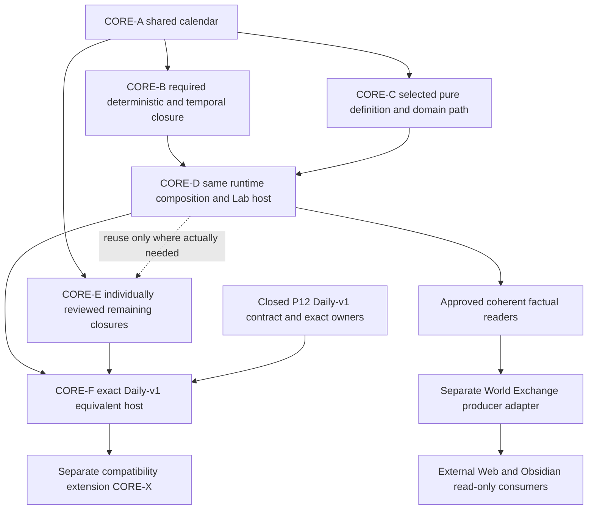

# Simulation Core extraction — architecture and migration contract

**Date:** 2026-10-13. **Workstream:** unnumbered infrastructure.
**Architecture investigation base:** `e940714bcc05c0d790e0cb9a7f614ee6b493e21a`.
**Production source inspected:** `origin/codex/phase12/canonical` at
`4cc31073f0ec6ba5c718084e4cebd6e914931d5d`.
**Authority:** user-selected Core extraction and autonomous compatible architecture
review/promotion. No production migration is delivered by this record.
Independent verdicts and exact reviewed refs: [review](SIMULATION_CORE_EXTRACTION_REVIEW.md).
First bounded executable contract: [CORE-A Master handoff](SIMULATION_CORE_A_MASTER_HANDOFF.md).

## 1. Decision and present capability

Extract one authoritative C# implementation into `Simulation.Core`, executable
without Unity. Unity remains the official Simulation Studio and consumes that
implementation. Lab and approved external execution hosts consume the same
application/domain authority; presentation and scenario orchestration own no
alternative simulation rules. This makes the existing architecture §2 direction
an incremental engineering commitment, not a claim that the current runtime is
portable. No numbered Phase, new world model, public mod loader, universal DI
container, remote transport or second runtime is introduced.

The current runtime cannot simply be moved into an SDK project. Its definition
graph, numeric calls, composition, persistence environment discovery and host
lifecycle still reach Unity. Compiling a selection of apparently pure files is
not evidence of a complete executable world. CORE-A proves only the real calendar
and age semantics; the later world-host milestone requires explicit composition,
commands, admission, advancement and observations on a selected domain path.

## 2. Current dependency inventory and its limits

The [file inventory](SIMULATION_CORE_DEPENDENCY_INVENTORY.csv) covers all **336**
tracked `Assets/_Project/Scripts/**/*.cs` files at the pinned production ref,
with Git blob identities. It distinguishes explicit engine-token candidates,
conservative transitive candidates and files for which the scan found no path.
Counts are 45 DIRECT_CANDIDATE, 242 TRANSITIVE_CANDIDATE and 49 NO_LEXICAL_PATH_NOT_PROVEN. It is a source audit, not a Roslyn binding/compilation proof. Comments/strings
are removed for graph classification. Declared class/struct/interface/enum names
are joined to identifier occurrences in other files; breadth-first propagation
records one shortest path to a direct engine candidate. Ambiguous identifiers,
conditional compilation, inheritance, generated code and reflection can create
false positives or hidden edges. No-path files are **not certified portable**.
Each extraction must prove its actual compiled dependency closure independently.

Reproduce against the pinned ref with `git ls-tree -r --name-only`, `git show`
for each tracked source, whole-word engine/declaration/identifier matching and
fixed-point graph propagation; CSV is path-sorted, with original Git blob IDs.
The semantic checks below supplement this conservative inventory.

| Current surface | Evidence and meaning | Required treatment |
|---|---|---|
| Engine references | 45 runtime files have lexical engine tokens after comment/string removal (46 before removal); 20 files contain 142 `Mathf.` calls across 125 matching lines. | Separate host plumbing from domain math; absence of imports proves nothing transitively. |
| Authoring | 13 ScriptableObject subclasses in 12 source files, including mixed `CapabilityFoundation` and two local-topology type assets. | Keep assets in Studio; convert to pure effective definitions before runtime composition. |
| Runtime assembly | No Assets asmdef/asmref. Domain and host share `Assembly-CSharp`; internal accessibility currently hides coupling. | Introduce a pure assembly in bounded closures; never make it reference predefined Assembly-CSharp. |
| Existing independent package | `Packages/com.simulation.world-exchange-producer/Runtime/Simulation.WorldExchangeProducer.asmdef`, `noEngineReferences: true`, `autoReferenced: true`. Only tracked asmdef. | Retain as projection integration; its purity does not make the domain portable. |
| Tests | 238 tracked C# test sources; 67 have lexical Unity namespace/UnityTest candidates before comment filtering. The remaining 171 are not certified portable. Editor/NUnit and host-object fixtures are mixed; PlayMode needs Unity lifecycle. | Move by capability closure, retain asset/bootstrap/UI/persistence-host integration in Unity. |
| Tools | Ten tracked Tools files, all Unity validation runner/evidence tooling. No SDK solution/project/global.json exists. | Add minimal .NET projects and host-specific evidence, preserve current Unity harness. |

### Concrete direct and transitive boundaries

- `CalendarDefinition`, `SimulationCalendar` (including `CalendarAgeCalculator`)
  and `SimulationDate` form a verified BCL-only closure. `SimulationTime` itself
  also binds authoritative mutation/advance dispatch and remains in place in
  CORE-A. Calendar conversion/age are consumed by real population, maturity,
  demographic and temporal semantics, not a replacement demo algorithm.
- `DeterministicRandom` is pure-looking and uses explicit source/stream state,
  keyed UTF-16 FNV-1a (`fnv1a64-keyed-utf16`, version 1), seed and draw indices.
  It is a future extraction candidate; preserve exact algorithms/conversions.
- `LogicalTimeline` has no engine import but uses calendar/date and internal
  `SpatialStableKey` declared inside `SpatialRouteKnowledge`. Extract that
  existing helper with its consumers if needed; do not duplicate it or introduce
  a second ordering/key algorithm. Temporal admission/activity boundaries stay
  intact. This larger closure is not CORE-A.
- `NpcRuntime` / actions / decisions, City, Market, Inventory and Item paths
  reach ScriptableObject content and numeric rules. `CityRuntime -> CityData`
  and `NpcActionRuntime -> NpcActionData` are concrete authoring links, not
  incidental `using` directives. Crime/justice/guards/travel/finite production
  also contain authoritative `Mathf` calculations. Port the rules, do not leave
  them in a Unity adapter.
- `CapabilityFoundation` mixes capability evaluation, definition identity,
  ScriptableObject classes and math in one file. A physical split and a reviewed
  effective-definition boundary are required before its runtime closure moves.
- P12 snapshot/codec logic largely uses typed binary/BCL operations. However
  `P12ACompatibilityDescriptorFactory` discovers Unity ScriptableObject content,
  `Application` build/platform paths, backend and assembly MVIDs. Hydration
  resolves effective definitions. The pure-looking codec alone cannot execute
  the accepted restoration profile outside Unity.
- `P12AContinuationStore` already has an explicit-path/file-operations seam;
  `Try*Current` conveniences use `Application.persistentDataPath`. Later move
  pure durable operations with the same flush/atomic replacement/failure
  behavior; keep path policy in the host. No replacement save format.
- `SimulationRuntime` remains the single application coordinator, mutation and
  temporal admission owner. Its Unity references, commands resolving Unity
  definitions and environment discovery prevent direct extraction now.
  `TesteSimulacao` is a MonoBehaviour mixing composition, startup/publication,
  inspector inputs and reporting. Move semantic composition into the same
  application authority incrementally; Studio Start/Update becomes a caller.
- `GMConsolePanel`, Observer views/bootstrap/time controller and asset classes
  remain Unity-side. Logging sinks may be adapted; logs never become truth.
  UI interaction, import/serialization, ScriptableObject conversion, scene and
  prefab linkage, Editor tools and Mono/IL2CPP compatibility remain host tests.

Tests with only NUnit/BCL assertions are *candidates*, not automatically portable:
check setup and transitive runtime fixture types. Pure calendar cases can be
shared now. Economy/population/politics/military suites follow their actual
pure-definition/runtime closures. P18 scheduling and P12 detached restoration
move only with real authority contexts. Unity lifecycle/authoring/UI tests stay;
LongRun moves only after the same composed domain path and causal comparison
are available, with its original horizon/seeds/assertions preserved.

## 3. Target assembly and repository organization

Choose **one shared source tree**, compiled by an embedded UPM assembly for
Unity and an SDK project for .NET. CORE-A starts this layout at the current repo
root, avoiding a one-shot move of Assets/Packages/ProjectSettings:

```text
Packages/com.simulation.core/
  package.json
  Runtime/Simulation.Core.asmdef        # noEngineReferences; one source owner
  Runtime/Calendar/*.cs                 # calendar closure first; later domains
src/Simulation.Core/Simulation.Core.csproj  # explicit Compile links to Runtime
src/Simulation.Unity/                   # later host adapter sources only
Assets/_Project/                        # existing Studio and integration fixtures
  Tests/EditMode/Editor/Calendar/       # pure shared cases + Unity-only checks
ProjectSettings/                        # Studio settings, existing location
Packages/com.simulation.world-exchange-producer/ # existing separate integration
 tests/Simulation.Core.Tests/Simulation.Core.Tests.csproj
 tools/Simulation.Core.CalendarDemo/    # bounded CLI, same Core API
 tools/Simulation.Lab/                  # future real scenario host, own design
Tools/UnityValidation/                  # current accepted Unity runner/packager
Tools/CoreValidation/                   # bounded .NET execution/evidence helper
```

Leading whitespace in the diagram is only presentation; all paths are root-relative.
SDK outputs (`bin`, `obj`, results) stay outside Assets and imported Packages.
Do not ship both Core source and an imported Core DLL in Unity. Keep one type
implementation and one source owner. The SDK project uses an explicit source
allowlist, no recursive inclusion of all legacy Scripts. Source package is an
internal composition boundary, not an approved public P19 extension API.

Initial Core: **netstandard2.1**, **C# 9.0** supported subset, no UnityEngine/
UnityEditor references or packages. Initial .NET test/demo host: **net8.0**,
SDK **9.0.315** (installed), pinned via global.json, no implicit SDK roll-forward.
These are first-proof toolchain choices, not perpetual production-host support.
A supported LTS toolchain upgrade must be reviewed before long-term headless
release; extraction does not require an SDK installation today. No records/init
setters/new language features are introduced during mechanical moves.

Unity version is **6000.3.9f1**, Test Framework **1.6.0**. Tracked Player settings
have `apiCompatibilityLevel: 6`, no per-platform override. CORE-A must record the
Editor-resolved level and target/backend; it does not change Player settings.
Targeting the narrower netstandard surface prevents importing Framework-only APIs.
Unity documents .NET Standard 2.1 and C# 9 support with limitations:
[Unity profile](https://docs.unity3d.com/6000.3/Documentation/Manual/dotnet-profile-support.html),
[C# compiler](https://docs.unity3d.com/6000.3/Documentation/Manual/csharp-compiler.html).
Microsoft documents .NET 5+ support for netstandard2.1:
[.NET Standard](https://learn.microsoft.com/en-us/dotnet/standard/net-standard?tabs=net-standard-2-1).
Predefined assemblies can consume auto-referenced custom assemblies, but a custom
assembly cannot depend back on predefined assemblies:
[assembly references](https://docs.unity3d.com/6000.3/Documentation/Manual/assembly-definitions-referencing.html).
Actual two-host compilation and serialization tests remain required.

Final dependency direction is host -> application/Core -> domain/BCL. Start with
one Core assembly; introduce smaller domain/application assemblies only for a
measured cycle/build/visibility need. No universal port for every BCL call.
Unity adapters may implement genuine host services (content conversion, lifecycle,
filesystem root, logging, platform compatibility facts). Core owns validation,
world identity/publication, mutation/epoch admission, temporal execution,
domain state, domain events/history, persistence codecs/restoration and rules.
Existing stores remain internal; use capability readers and admitted commands.
No global friend-assembly grant or Store exposure to make compilation pass.
## 4. Authoring, composition and execution boundary

Unity assets convert to validated pure effective definitions before publication.
Conversion must resolve stable semantic definition IDs, reject duplicate/dangling
references and invalid configurations, and preserve effective values, ordering,
content/version identity and deterministic genesis fingerprints. Asset GUID/path,
Unity instance ID, asset discovery order and localized labels cannot replace a
semantic ID. Equivalent input definitions must yield equivalent authoritative
content; no implicit host defaults or partial host degradation.

Retain current ScriptableObject workflows and explicit profile fixtures. Split
mixed classes only as each consumer migrates; do not invent a universal content
language or general import graph now. Authoring adapters produce definitions;
they do not own world state, evaluate game rules, mint runtime IDs independently,
or mutate a running world behind its authority. Seal/copy effective inputs at
composition according to their existing contract. CORE-A specifically preserves
CalendarDefinition's public serialized fields and SimulationCalendar's internal
snapshot, including existing legacy fallback; broader immutable-definition design
is a later contract, not an incidental breaking change.

Refactor the existing SimulationRuntime in place, extracting actual dependency
closures and introducing concrete ports only at proven engine boundaries.
A host supplies effective content/config/calendar, deterministic RNG root,
profile/compatibility facts and environmental services. The same application
coordinator validates composition, builds a private graph, finalizes callbacks,
publishes WorldId only after healthy genesis, admits commands and advances logical
time. Failed genesis publishes nothing; load preserves identity, fork remains a
new WorldId plus provenance. No alternate `.NETSimulationRuntime`/demo engine.

Owner-thread affinity is captured from the chosen host at explicit attachment,
not inferred from Unity Start as a universal concept. It preserves the existing
single admitted operation protocol, contexts, mutation epochs and advance lease.
No new global synchronization authority. Hosts call controlled AdvanceDay or an
approved temporal entry; frame time/wall clock never selects authoritative order.
An operation's external payload/authority/logical boundary/order and causal
outputs remain reconstructible under existing contracts. Domain events and
selective diagnostics cannot replace retained authoritative state/inputs.

## 5. P12 closed contract and compatibility gates

Current P12 State at `4cc31073...` records formal **CLOSED** on 2026-10-13,
closure marker `fbf06fa887a29b92be004d864f4ee98d90926d4a` and audit base
`c1cc0b0bd69e804391bab0e7d19ab6130781ed6f`.
P12-A–G are promoted within same-build/current-host `UnityBootstrap-Daily-v1`.
Final corrected P12-A source `d54f0f1074f71061a9f546d4b30859f538a69e09` has
ALL **3060/3060**, Smoke **5/5**, codecs **131/131**, startup inspection failure
**1/1**, persisted continuation parity **1/1**, zero failed/skipped/inconclusive.
Evidence: `docs/validation/P12AContinuation-20261013/VALIDATION.md` and the
formal closure record at that production ref; these are historical executed
results, not new migration validation. P13 remains WAIT_DEPENDENCY; no P13 or
new save-profile readiness follows from this work.

The selected composition uses its dedicated P9-B authored geography. It excludes
P10 LocalTopology, P14 material state, P18 intraday, P19 mods and P20 populated
shared activities. Preserve fail-closed admission for unsupported state and
exact current owner/provider/epoch inventories; do not widen the profile for a
Lab consumer. Current inventories are verified against current code/closure,
not frozen forever to an older chat's 275-section sample.

Three separate milestones:

1. **Code extraction:** identical domain implementation under a pure assembly.
2. **Equivalent non-Unity host:** exact selected effective world, owners,
   admission, deterministic commands/advances and restoration compose outside
   Unity, with demonstrated boundary parity. This requires a later reviewed
   host/definition/compatibility design; CORE-A does not deliver it.
3. **Official save-profile compatibility extension:** explicitly approve and
   validate any cross-host, cross-build, backend/numeric or content migration
   promise. Same values or successful compilation do not satisfy this milestone.

P12 build descriptors include assembly identities/MVIDs, Unity build/platform/
backend and numeric context. Moving even CalendarDefinition to a new assembly
creates a new build identity. Do not mask, hardcode or remove incompatibility
checks to load pre-extraction files. Preserve the known old build for loading
its old saves; rollback uses that build and save together. New extracted Unity
build must save/detached-load/restore/continue within itself, and incompatible
old descriptor/save must fail closed without publishing a world or overwriting
the slot. No save conversion is authorized. Retain binary field meanings,
ordering, content fingerprints, allocator/RNG/record sequences and failure atomicity.

Completed-boundary tokens stay immutable, ephemeral and owned by the same runtime:
only a successful positive outer advance may issue one; reject idle/partial/
faulted/throwing boundaries, stale epochs and active operations. Host extraction
cannot replace this with an idle flag or manufacture a token for a test. P12
capture, detached hydration, restoration validation and publication remain the
same protocol. Durable filesystem adapters must preserve flush/replace behavior
and missing-versus-inaccessible slot semantics; inaccessible startup fails closed.

## 6. Incremental roadmap and dependency graph

All rows after CORE-A are scoped design targets, not invented implementation
readiness. Refine one real consumer at a time; closure requires working two-host
parity, not merely moving every file in a named folder.

| Workstream step | Entry / current readiness | Bounded outcome and gate |
|---|---|---|
| CORE-A Calendar shared assembly | Independently reviewed handoff -> READY_FOR_IMPLEMENTATION after architecture promotion | Real calendar/age closure, same source under Unity/.NET, portable assertions and CLI, authoring/P12 integration gates. |
| CORE-B Deterministic primitives and temporal closure | READY_FOR_TECHNICAL_DESIGN after architecture promotion; implementation WAIT_DEPENDENCY on A and its own review | Audit/move existing deterministic streams, keys and logical-time closure; retain contexts/order. Do not move all P18 consumers by implication. |
| CORE-C One pure-definition/domain consumer | READY_FOR_TECHNICAL_DESIGN after architecture promotion; implementation WAIT_DEPENDENCY on reviewed closure and required A/B capabilities | Select delivered P14-B finite source as recommended first useful world-path consumer; extract its actual economy/item/definition closure or choose a smaller delivered path if audit warrants. No fake adapter rules. |
| CORE-D Shared runtime composition + Lab host | WAIT_DEPENDENCY on selected C closure and reviewed host/definition contracts | Same runtime admitted initialization/operation/advance/read path, explicit profile; first real finite-source Lab scenario when dependencies exist. No universal host framework. |
| CORE-E Remaining domain closures + default Core workflow | WAIT_DEPENDENCY on individual reviewed closures, not all-or-nothing D | Incrementally population/NPC/economy/politics/crime/military/spatial/Knowledge, retaining one implementation; run relevant domain suites without Unity. Integration order follows actual references. |
| CORE-F P12 equivalent .NET continuation host | WAIT_DEPENDENCY on exact selected Daily-v1 owner/definition/runtime closure and host design | Capture/durable load/restoration/continuation under a declared host/build, exact owner inventory and negative cases; no automatic cross-host interchange. |
| CORE-X Save compatibility extension | WAIT_DEPENDENCY on explicit compatibility scope/design/evidence | A separately approved cross-host/build promise only when requested; not necessary for A or ordinary domain extraction. |



DAG edges mean actual consumed capability/design gates; the E -> F edge requires
only the Daily-v1 owners, not every future domain. A/C can be prepared in parallel
with read-only B audit. Runtime/temporal/P12/definition integration uses owned
serial windows. P19 loader is not an edge. No Core workstream is a blanket
prerequisite for independent numbered-phase work.

## 7. Determinism and test migration gates

For every migrated closure compare identical effective definitions/config/calendar,
identity seeds, RNG root/draw indices, external input payload/authority/ordering
and logical boundaries. Compare authoritative values, stable IDs, committed
mutations, failures/rejections, pending temporal work and relevant snapshots or
semantic export. Never use logs/UI/World Exchange alone as state equivalence.
If execution diverges, diagnose before promotion; do not normalize authoritative
differences or silently widen tolerances.

Integer/calendar/key/RNG tests require exact existing outcomes and exceptional
boundaries. Future `Mathf` port design must pin RoundToInt tie behavior, overflow,
clamp/min/max/NaN/infinity/signed-zero/Approximately/Pow semantics and float
conversions. Mono/CoreCLR/IL2CPP may differ in math libraries, optimization and
rounding; a global replacement with System.Math is not approved. Introduce one
reviewed domain numeric implementation only where necessary, validated against
canonical outcomes. Cross-backend guarantees require their actual execution gates.

Move portable tests only after compiling their full closure with no engine
references. Share assertions/case data when practical; separate host setup and
asset/UI checks. Retain complete original selection/case mapping so relocating
classes cannot drop tests unnoticed. Pure .NET results do not replace bootstrap,
asset conversion, Unity import/serialization or selected P12 integration tests.
During this migration existing full Unity EditMode + official Smoke remain
required for integration promotions; LongRun remains required when causal,
daily-loop or long-horizon behavior changes. First CORE-A also requires its
focused .NET/Unity cases and P12 gates in the handoff. Future per-domain .NET
promotion substitution requires its own reviewed gate contract, not an agent
assuming no Unity run is needed because an asmdef says noEngineReferences.
## 8. Operational workflow, evidence and Skills

A Core-only worktree may run .NET restore/build/test without opening Unity or
creating Library. Documentation worktrees require no Unity import. Unity adapter,
asset, assembly-integration or profile changes use a separate owned Studio
validation checkout/window. CORE-A still needs one such integration run; it does
not eliminate all Library needs. Never share mutable Library directories between
parallel checkouts. No junction/symlink/Accelerator strategy or cleanup is part
of this architecture.

The canonical P12 evidence packager is **implemented** under Tools/UnityValidation
at the inspected production ref. Historical architecture policy/Skill text saying
it is still future is stale for that delivered capability; preserve historical
evidence and use the production README/implementation review for actual support.
Its input roots are Assets/Packages/ProjectSettings/Tools/UnityValidation; it does
not establish .NET source/toolchain input equality. Its XML schema/path redaction
is deliberately bounded; do not pass TRX or unsupported .NET assembly reports to
it or edit reports to manufacture acceptance.

CORE-A's .NET side keeps a complete original TRX result bundle under the evidence
policy transition rule, with a manifest covering SDK/global.json, Core/test/demo
projects and explicit linked sources, lockfiles, runner/commands, OS/CLR/architecture,
case identities/results/counts and before/after input digests. Full original
TRX is permanent evidence only after content/privacy review; originals/logs also
follow protected diagnostic retention. No hashes-only or aggregate-only proof.
One small Tools/CoreValidation helper may capture identity, run dotnet and verify
expected complete results; no generic packaging framework or port of the Unity
packer is required. Its exact acceptance algorithm is in the first handoff.
A future normalized TRX adapter requires its own independent losslessness review.
Unity evidence uses the delivered packager unchanged; CORE-A supplies a sidecar
manifest for added SDK/linked-test inputs outside the Unity packer's roots.

AGENTS, Execution Model and the implementation/review/dependency-refresh Skills
must direct workers to name the host, target framework, actual input closure and
required gates, and distinguish compile, behavior and save compatibility. This
candidate adds those operational directions. It does not waive numbered-phase
validation or claim current domain tests have moved. No new automation/background
job or unrelated implementation wave is started.

## 9. Worktree/disk observations and expected benefit

Read-only local inventory on 2026-10-13 found **230 registered worktrees** and
**114 existing root Library directories**. One inspected P12 implementation
Library had **34,389 regular files / 2,017,129,311 logical bytes** (~1.88 GiB),
with no unreadable/reparse files in that traversal. The architecture checkout
had no Library. Traversal excluded reparse directories and did not follow links.
This is a single sample of logical file lengths, not allocated filesystem bytes,
a total across worktrees, a benchmark or proof of duplicate content.

Expected: a clean Core/docs worktree avoids Unity import and its Library; it still
uses source checkout/Git history, NuGet cache and small bin/obj/results. Shared
normal NuGet caching needs no Unity cache sharing. Future domain .NET runs should
avoid Editor startup/import overhead; **no elapsed-time speedup or measured
migration saving exists yet**. CORE-A records cold/warm restore/build/test time,
bin/obj/result bytes and whether Library was created, on the same identified
machine/toolchain; compare with a Unity focused run without calling unequal
suite selections a speedup benchmark. Do not multiply 114 by the sample as a
measured saving. Existing caches/history are not deleted by this task.

## 10. Active ownership, future phases and consumers

Read-only worktree preflight found the main checkout on a P20 joint-travel branch
with a ShaderGraph settings edit; P12 implementation checkout is on the formal
closure candidate at the current P12 tip with EditorBuildSettings and ShaderGraph
edits. Those files/worktrees remain untouched. The clean architecture checkout
is reused for this documentation candidate. Registered branches are not proof
that an agent is idle; Master rechecks live ownership before each integration.

| Track | Impact of this architecture |
|---|---|
| P10 generated topology | Pure generation can migrate after stable definition/ID/topology closure; preserve reproducible inputs and promoted A/B scopes. No redesign of Ruin. |
| P13 history/fork | No blanket Core dependency; retain new WorldId/provenance and causal history requirements. Host/build identity may need alignment when its design consumes persistence. P12 closure alone does not unlock it. |
| P14 material flow | Existing finite reserve/stock authorities stay one implementation; proposed first useful Lab path needs item/market/definition/math closure. No trade AI. |
| P15 construction | Preserve stable structure identity and mutation/export seams; no new material debit/profile membership. |
| P16 movement | Preserve position/supply/receipt authority and exact ordering; spatial owner/runtime integration serialized. |
| P17 War | Reuse persistent War authority and accepted goal/termination separation; Core move adds no Warfare system. |
| P18 temporal | Closed scope stays closed; move actual timeline/lease/activity semantics, never rebase time on host frames. |
| P19 mods | Public surface remains separately designed, loader deferred; no prerequisite for official Core/Lab use. |
| P20 activities | Preserve A synthetic operation, B Daily census admission, C joint civil travel identities. No two-person universal bound or synthetic shared actor. |
| P12 | Closed same-build/current-host guarantees remain; new host/profile compatibility is separately gated, never silently extended. |

Documentation promotion is UPSTREAM_IRRELEVANT to unchanged active implementation
inputs/contracts. Actual assembly moves are REVALIDATE/REINTEGRATE for consumers,
Unity serialization and P12 build identity, even if the source algorithm is
unchanged. No closed Phase is reopened merely for code organization. No active
numbered-phase ref is modified by the architecture promotion. Master must port
only the reviewed documentation/implementation delta onto current executable
canonical; do not merge this architecture branch's older Assets tree into P12.

Lab is an official scenario host using same Core initialization, admitted operations,
advance and capability readers. The calendar CLI is only a first domain proof,
not the previously planned finite-source world Lab. A later Lab scenario shows
reserve/stock/exhaustion through real Core rules and approved coherent reads.
Simulation-External at `0ce8403ba05f778db6850f566a974a4c56cf4edb` consumes versioned
World Exchange v1/v2 facts, not P12 DTOs or direct Stores. Current delivered
Simulation-side producer and External v2 collectionCoverage stay separate from
Core; External docs still describe their original fixture foundation. No TS rule
port, live authoring/command transport, second world authority or domain import
of World Exchange types is introduced. A .NET execution host may later emit facts
through the same approved reader/producer seam; Web/Obsidian remain consumers.

## 11. Risks, rollback and stopping boundaries

- **Assembly/serialization:** verify shared source uniqueness, auto-reference and
  inline asset round-trip. Keep script GUIDs/fields/names stable; no rename or
  Unity attributes in Core to conceal a failed move. If a real serialization
  migration is necessary, return to bounded design before changing content.
- **Build compatibility:** assembly MVID changes are real; old build + old saves
  remain paired. New-build files must not overwrite the old save during negative
  tests. Cross-build conversion requires separate approval/design.
- **Hidden closure/internal cycles:** no source-copy shim, engine stub, global
  friend assembly or Store exposure. Split a real dependency or stop that slice;
  unrelated work continues. Inventory is advisory, compilation is mandatory.
- **Numerics/ordering:** no rounding, key/hash, RNG, sort, dictionary iteration,
  temporal admission or mutation changes during mechanical extraction. Diagnose
  parity failures before advancing the DAG.
- **Operational:** .NET test discovery must be nonempty and complete. Capture
  SDK/CLR/locks/source identity; no implicit target/runtime upgrades or unsupported
  evidence normalization. Full Unity gates remain until explicitly replaced.
- **Rollback:** each extraction is an additive isolated commit sequence with old
  path -> new path mapping. Before integration preserve a known validated old
  build/content/save fixture and candidate refs. Revert the integrated migration
  with normal additive Git commits in a serialized window, restore the matching
  prior host/build artifacts and validate; never force-reset shared history,
  delete unrelated worktrees, mix builds/saves or silently reset user data.

No unresolved product decision is needed for CORE-A. Wider definition/numeric/
world-host/compatibility details remain named later design gates rather than
implementation-worker inventions. This record authorizes a reviewed bounded
first implementation handoff only; full extraction remains incremental.
