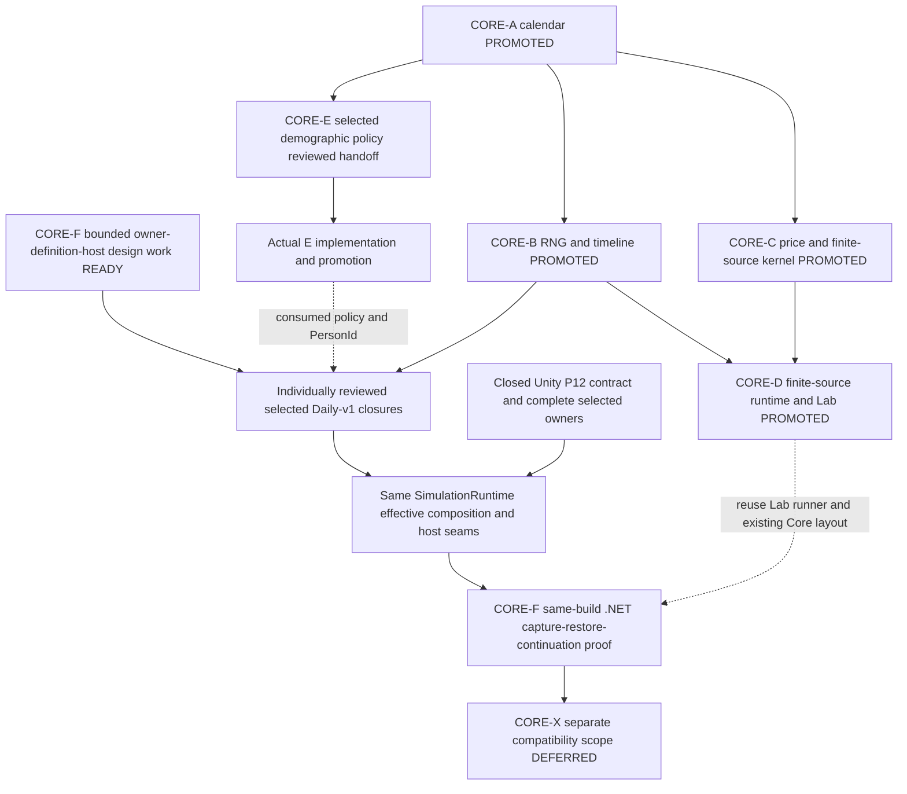

# CORE-F readiness — exact Daily-v1 closure and host design entry

**Date:** 2026-10-14. **Production authority:** Core canonical
`ad7a18899a13ec42a3d2b6b3098dff2f0a318492`.
**Architecture baseline:** `63d3b8352a450b27b9a5f593c4ea166c0343c59e`.
**Verdict:** CORE-F implementation WAIT_DEPENDENCY. Bounded inventory/technical
host-design preparation is READY_FOR_TECHNICAL_DESIGN; this packet fixes its
scope/exit criteria, not a completed host API or implementation permission.
[Independent review](SIMULATION_CORE_E_F_REVIEW.md) covers this assessment and
[CORE-E handoff](SIMULATION_CORE_E_MASTER_HANDOFF.md) separately.

## 1. Actual delivered capability and evidence

A–D are promoted on the pinned Core history. `docs/CORE_STATE.md` there records
their implementation, exact-tip reviews and promotion evidence. The production
SDK project links exactly ten runtime sources: CalendarDefinition,
SimulationCalendar, SimulationDate, DeterministicRandom, StableKeyEncoding,
LogicalTimeline, MarketItemDefinition, MarketPriceCalculator,
FiniteSourceProductionKernel and FiniteSourceScenarioRuntime. Unity consumes
these same sources through one noEngineReferences assembly.

CORE-D's fixed in-memory finite-source Lab path is real shared application/domain
execution: initialization, prepared operation, revision-checked application and
immutable readback. It is not SimulationRuntime, the City daily economy or a P12
world host. P14 remains excluded from Daily-v1. D validation records 113/113
.NET cold and warm, locked Lab output parity, Unity FiniteSource 41/41, ALL
EditMode 3120/3120, Smoke 5/5 and independent exact-tip applicability PASS.
The public normalized D archive was inspected in this assessment: two complete
TRX reports, 113 individual passing results each. This is retained result
inspection, not a new domain run or fresh private-original comparison.

Source evidence is retrievable with `git show <production-base>:<path>` and
`git archive` for the pinned production ref; architecture checkout code is older.
Primary paths are `docs/CORE_STATE.md`, `docs/design/CORE_D_SHARED_RUNTIME_LAB_TECHNICAL_DESIGN.md`,
`docs/validation/CORE_D_ScenarioLab/VALIDATION.md`,
`src/Simulation.Core/Simulation.Core.csproj`,
`tests/Simulation.Core.Tests/Simulation.Core.Tests.csproj`,
`tools/Simulation.Lab/Program.cs` and `Tools/CoreValidation/README.md`.
No earlier A/tooling WAIT claim overrides their later promoted State/code.

## 2. Exact selected profile and owner reachability

The scope is exactly the closed same-build/current-host P12 Daily-v1 contract,
not every public runtime API or every future system. Use the dedicated
`Assets/_Project/Data/Simulations/Simulation-DailyV1.asset`, its effective
configuration and the P9-B authored-geography contract. Preserve supported
bootstrap, ordinary admitted operations/commands and reachable state, plus the
specific synthetic restoration cases accepted by P12-G. Empty startup stores
are not evidence that their Required owners can be deleted.

The source-authoritative census is `P12ADailyV1Census` in
`Assets/_Project/Scripts/P12AContinuationImage.cs`. Its arrays, dynamic-key checks,
exact key-set equality, schema, roles and owner-instance alias rules govern.
The [complete 89-family key inventory](SIMULATION_CORE_F_OWNER_SECTIONS.csv)
records source lines/base for all 48 fixed Required keys, 13 fixed ExplicitlyEmpty
keys, 22 per-NPC prefixes, four per-City prefixes, one per non-Person-NPC residence
prefix and one per-Person life/residence prefix. Rows are section families,
not a claim that only 89 runtime sections exist.

The current shape equation, from TryCreate, is:

```text
61 + 22*N + U + P + 4*C
N = live NPC owner key count
U = non-Person NPC residence key count
P = Person life/residence owner key count
C = City owner key count
```

It requires at least one NPC and City; all NPC/City families must have matching
key sets, and U must refer to NPC keys. This supersedes older chat/sample
65+20*N+U+P or 275-section assumptions. Do not freeze the profile to a startup
total. Required permits the owner contract's legitimate zero rows;
ExplicitlyEmpty enforces zero. AliasGroup identity preserves shared live owner
instances, not just equal serialized counts.

| Owner closure | Current authority/capture source anchors under Assets/_Project/Scripts | CORE-F obligation |
|---|---|---|
| Identity/causal roots, full allocator, sequence, effective config, calendar/RNG and genesis | RuntimeIdentity.cs, RuntimeIdentityCensus.cs, RuntimeIdAllocatorCensusProviders.cs, SimulationRecordSequenceCensus.cs, P12ACausalRootOwnerCodec.cs, P12CRuntimeIdentityOwnerSnapshot.cs, P9GenesisManifestContinuationSnapshot.cs | Extract actual root ownership, all continuation-relevant counters/state and ID/order semantics, not merely event/decision registered counters. Shared A/B primitives are satisfied, root composition/ownership is not. |
| P8-A geography and legacy network | SpatialAuthority.cs, SpatialGeography.cs, SpatialRuntime.cs, SpatialAuthorityContinuationSnapshot.cs, P12ACSpatialAuthorityCodec.cs, P12ASpatialNetworkOwnerCodec.cs | Exact P9-B geography and legacy network/ID graph; preserve physical/legacy rules and empty excluded passage/position/route-plan owners. No new P8 profile. |
| City/population and Person/genealogy/materialization/residence | CityRuntime.cs, Population/SettlementPopulationRuntime.cs, Person/*, Genealogy/*, P12DDailyV1OwnerPackage.cs, P12ACityOwnerSetCodec.cs, P12APersonStoreOwnerCodec.cs | Extract state/receipt and lifecycle relationships, exact instance binding and staged validation. E extracts policy/PersonId only; this large closure remains. |
| NPC execution/economy/travel | NpcRuntime.cs, NpcActionRuntime.cs, NpcDecisionSystem.cs, MarketRuntime.cs, InventoryRuntime.cs, MoneyAccountRuntime.cs, MerchantSystem.cs, TravelSystem.cs, P12DNpcRootOwnerSnapshot.cs, P12ANpcOwnerDecoder.cs | Effective definitions and numeric rules, every NPC state/Knowledge/plan/receipt family and City Market rows, ordinary operation admission. CORE-C's price/kernel is not full owner closure. |
| Justice/crime/social appraisal | CrimeSystem.cs, GuardSystem.cs, JusticeSystem.cs, P12EJusticeRecordsOwnerSnapshot.cs, P12ECrimeSocialAppraisalOwnerSnapshot.cs, P12EDailyV1OwnerPackage.cs | Live enabled crime/guard/justice paths, receipts, outcomes/Knowledge/reactions. Empty initial warrants do not remove later reachable state. |
| Political/institution/faction/property/estate | PoliticalClaimStore.cs, PoliticalSupportStore.cs, PoliticalDecision.cs, PoliticalKnowledgeStore.cs, Faction*, Institution*, Office*, Property*, Estate*, P12EDailyV1OwnerPackage.cs, P12FDailyV1OwnerPackage.cs | Preserve Required owners and ID links even when currently empty/no ordinary Daily-v1 writer. Accepted synthetic P12-G binding is restore evidence only, not a new political producer. |
| Military/conflict/War/Battle | ArmedForce*, Contingent*, PersistentConflict*, PersistentWar*, PersistentBattle*, P12EDailyV1OwnerPackage.cs | Preserve Required graphs/validators, including legitimate zero states. Military is not a SimulationModule toggle; do not invent new enabled gameplay or silently drop owners. |
| Knowledge/commitments/terminal external inputs | CommercialKnowledge.cs, SpatialKnowledge.cs, AdventureSiteIntelKnowledge.cs, ExplorableSiteKnowledge.cs, ActorChoice*, ScheduledDirective*, TravelParty*, Expedition*, P12FDailyV1OwnerPackage.cs, P12FCommitmentOwnerSnapshots.cs and P12A NPC/F codecs | Exact supported Knowledge, inputs, pending commitment and already-applied effects, future-due ordering, duplicate/replay prevention. Preserve exact-empty topology/receipt dispositions. |
| Admission/capture/staging/publication | SimulationRuntime.cs, SimulationBootstrapComposition.cs, P12ADailyV1ImageComposer.cs, P12ADailyV1ImageOwnerDecoder.cs, P12GDailyV1RestoreCoordinator*.cs | One coordinator, same graph/admission contexts/epochs/lease/token, detached capture and private hydration/validation; atomic publication, no second .NET runtime. |

The table is a bounded semantic closure map, not yet a compile-ready list of all
transitive types. The CSV enumerates all section keys but is not an epoch/writer
or compilability proof. The next design must join each row to its actual provider,
owner instance, mutation/epoch paths, export and staged hydration hooks. Reuse
closed P12 reachability and closure matrix evidence rather than repeat an audit
of arbitrary APIs. Migration-specific edges must still be proven on new assemblies.

## 3. Remaining Unity-owned definitions: exact authored input census

The [39-asset input inventory](SIMULATION_CORE_F_AUTHORED_INPUTS.csv) follows tracked
nonnull YAML GUID references from the dedicated root, resolves script GUIDs through
tracked .meta files and records asset Git blob identities. It finds:

| Authoring type | Assets reachable in this fixture |
|---|---:|
| SimulationConfigData | 1 |
| CityData | 2 |
| NpcData | 10 |
| NpcActionData | 12 |
| NpcStatusData | 4 |
| NpcJobData | 5 |
| ItemData | 5 |

This is a reproducible authored-reference census, not a substitute for Unity
serialization/default resolution or effective configuration validation. Fields
omitted from YAML may take C# defaults; next design must capture all effective
values and ordering after resolution, semantic definition IDs/revisions and
content/genesis fingerprints. CalendarDefinition is embedded serializable data
and already Core-owned. No selected TraitData, CapabilityAttributeData,
ExplorableSiteData, LocalPlaceTypeData, LocalConnectionTypeData or OrganizationData
asset is reached in this fixture. Their optional typed fields/validators may
still affect compiled closure; empty inputs do not justify engine stubs.

The selected asset enables Economy, Merchant, Crime and GuardCrime. Their live
behavior cannot be removed merely because the first fixture has an empty warrant
or directive list. Dedicated P10 Ruin/site reference is null; arbitrary GeneralTest
scene/config content is not an authority over this profile. Keep unselected
definitions outside support; retain rejection paths rather than silently ignoring
populated unsupported state. The fixture's two Cities/ten NPCs are initial data,
not universal profile cardinality bounds.

Required design work: pure effective City/Item/NPC/job/action/status definitions
and configuration, validated stable ID graph, immutable or sealed effective
values, Unity asset conversion and .NET fixture composition with matching values.
Current direct consumers include CityRuntime/MarketRuntime/InventoryRuntime,
NpcRuntime/NpcActionRuntime, CoreWorldCommandHandlers and bootstrap/genesis.
Core's MarketItemDefinition covers only its bounded price/production contract;
it does not replace the entire ItemData dependency graph. CapabilityFoundation
mixes pure evaluation/identity with ScriptableObjects and needs an actual split
where compiled consumers require it. Do not design a universal JSON/content schema.

## 4. Missing capability, missing evidence, and satisfied requirements

| Area | Classification | Next bounded work |
|---|---|---|
| Calendar/date/age; deterministic streams/keys/logical time; finite-source kernels/runtime/Lab | SATISFIED for their exact A–D contracts | Reuse source/validated behavior; not evidence of full world hosting. |
| P12 Daily-v1 capture, owners, codecs, storage, detached restoration and continuation in Unity | SATISFIED current-host capability and accepted closure | Preserve closed contract; no new P12 checkpoint or product decision to reopen it. |
| Exact pure effective definition graph and asset conversion consumed by runtime | MISSING_CAPABILITY + bounded technical design | Define and extract actual selected definitions with conversion/fingerprint parity and explicit rejection. |
| Full selected owner/runtime/admission closure in Core | MISSING_CAPABILITY + extraction/integration design | Individually reviewed closures, single source and real compile proof; no direct Store exposure or globally public internal APIs. |
| Host composition and environment seams | MISSING_CAPABILITY + host technical design | Reuse the one SimulationRuntime/bootstrap/staging authority; supply effective inputs, owner thread attachment, explicit deterministic controls, build/numeric descriptor and filesystem root. |
| Non-Unity save-load-restore-continue and parity/rejection matrix | MISSING_EVIDENCE after above capabilities | Same host/build round-trip, complete owner/alias/state comparison and control continuation at later boundaries. Existing Unity results do not prove it. |
| Owner-thread/quiescence, completed boundary token, mutation epochs and advance lease | Existing supported-profile protocol; MISSING_EXTRACTION/INTEGRATION evidence | Carry it intact through admitted host attachment/operations. No idle flag/token fabrication, second mutation authority or global locking framework. |
| Cross-host/build/backends/content save interchange | OUTSIDE_SCOPE; CORE-X DEFERRED | Only a separately approved compatibility scope/design/proof can unlock it. |

Actual code still has 333 tracked runtime C# sources under Assets at ad7a188,
46 lexical engine-token candidate files and 140 Mathf tokens (comments included).
These are search triage counts, not a dependency/portability proof. The original
336-file extraction CSV stays historical. Extract exact per-closure source maps
instead of certifying apparently engine-free files by token absence.

## 5. Host and persistence design constraints already settled

- The same SimulationRuntime validates composition, privately constructs the graph,
  finalizes callbacks and publishes WorldId only after healthy genesis; failed
  genesis publishes none. Restore preserves WorldId. P13 fork remains separate.
- Host attachment captures owner-thread identity explicitly. All admitted operations
  retain existing contexts, mutation epochs and single advance lease. Live issuance requires a fully successful positive outer
  advance. Preserve the existing separately validated restored-continuation path:
  `SimulationRuntime.TryAdmitRestoredDailyBoundary` accepts a private validated
  candidate, preserved positive completed sequence/day/WorldId and matched fresh
  owner vector/epoch, and creates an ephemeral token with RestoredContinuation
  provenance. It preserves an already proven completed boundary; it does not
  manufacture a simulated advance from hydration or idleness. Failed/throwing/
  faulted/partial states or stale vectors cannot become capture eligible. Temporal
  order is logical, never frame/wall time.
- Preserve P12 exact owner roles, cardinalities and instance aliases; all supported
  ingresses and reachable state remain covered. Do not reinterpret unsupported
  direct external calls as ordinary supported gameplay to fill tests.
- P12ACompatibilityDescriptorFactory currently walks ScriptableObjects and uses
  Unity Application/build/platform/backend and loaded assembly MVIDs. A .NET host
  needs truthful host/build/numeric context, not fake Unity values or suppressed
  checks. Resolve its exact descriptor encoding/identities in the host design.
  The existing Unity factory/descriptor meaning must remain compatible within its
  own build. Extraction changes are new builds; no old-save conversion is approved.
- P12AContinuationStore already has explicit path/file-operations seams with flush,
  atomic replace/move and absent-versus-inaccessible failure semantics. Keep its
  durable behavior; move Application.persistentDataPath convenience to Unity.
  No new persistence format, lossy JSON save or alternative coordinator.
- Both hosts eventually need their own same-build round-trip. Compare equivalent
  authoritative states across hosts on common effective inputs, separately from
  loading one host's file in the other. Reject incompatible descriptors without
  publication, mutation or slot overwrite. No cross-host save claim.
- Keep callbacks, bindings, late revalidation, failure atomicity, already-applied
  effects, full allocator/root state, schema/ordering and causal input history.
  Restore must not replay effects or issue a token merely because hydration ended;
  its accepted restored-boundary admission/recapture/provenance checks still apply.
  Use P12-G closure matrix as the finite supported-state test obligation set.

## 6. Finite closure-oriented design plan / Master design handoff

Master may schedule the following design-only work now, in isolated workstreams.
These are ordered work packages within CORE-F, not new checkpoint IDs or
implementation-ready deliveries:

1. **Definition and owner source closure.** Join all 89 CSV families to live providers,
   exact owners/epochs/ingresses and export/hydration paths at current canonical.
   Trace the 39 authored assets to effective values including omitted/default fields;
   specify stable definition interfaces/conversion and placement for every consumed
   type. Partition actual strongly connected source closures, identify each engine
   edge/numeric rule, and propose bounded migration units. Explicitly separate
   runtime compile dependencies from reachable profile state. E's policy closure
   can be consumed after its implementation promotion, not after this design alone.
2. **Application/host technical design.** Using that partition, fix the same-runtime
   initialization and advance/command/read boundary, owner-thread attachment,
   environment ports, complete staged restore binding/publication and supported
   host/build/numeric identity. Map selected required-but-zero owners and exact-empty
   sentinels; do not instantiate a broader gameplay profile. Keep effective semantic
   composition in Core and asset/environment conversion in Unity. Record exact
   sources, internal API handling and integration order before dispatch.
3. **Validation and first implementation units.** Fix complete two-host owner and
   boundary projections for initialization, successful multi-day progression,
   ordinary admitted inputs, capture/save/detached load/stage/restore/continue,
   required populated/empty bindings and rejected/faulted cases. Include corrupt/
   inaccessible slot, stale/partial token, descriptor/content mismatch, replay/
   duplicate effects and old-world/slot atomicity. Preserve original P12 closure
   obligations; compare actual outputs, not logs/World Exchange alone. Define
   focused, full Unity/Smoke and causal LongRun gates plus .NET cold/warm/complete
   evidence. Independently review exact design, revise until PASS, then hand off
   only the first bounded implementation-ready closure(s).

Exit of this design work is a durable reviewed source/definition/owner/host contract
with no unresolved authority/API/profile boundary left to an implementation worker.
CORE-F implementation becomes ready only when its named production dependencies
are promoted and exact host design passes; this packet intentionally claims neither.
Design can proceed while CORE-E implements. Do not postpone it until unrelated
future domains or P19 loader are finished. No code implementation in Architect stream.

## 7. Updated capability DAG and shortest safe path



A–D already deliver real .NET domain tests and a bounded authoritative Lab scenario.
E adds the next production rule to .NET tests. Other individually reviewed closures
turn Unity into a consumer for each migrated rule progressively; F proves the exact
Daily-v1 runtime/continuation outside Unity. No extraction of every future domain
is necessary for F, but no admitted owner or reachable causality may be omitted.
Lab can consume the same migrated application boundary; no second simulation engine
or World Exchange snapshot viewer pretending to execute authority.

Core-only development/test and docs checkouts need no Unity import/Library. Keep
one owned Studio validation window for assembly/adapter/profile integration;
never share mutable Library across worktrees. Savings follow from avoiding imports
for genuinely Core-only tasks; no measured global speed/disk claim, cache deletion,
junction strategy or blanket Unity gate waiver. Current Lab regressions stay.

## 8. Readiness, concurrency and decisions

- **Next implementation-ready slice after E design PASS/promotion:** exact E handoff.
- **Next design-ready work:** the three bounded F work packages above. Read-only
  inventory can run PARALLEL SAFE; F design and E implementation use independent
  worktrees and serialize any eventual package/project/owner/runtime edits.
- **MUST WAIT:** CORE-F implementation on exact selected closure and approved host
  design; CORE-X on explicit compatibility scope. No claim that the full E family
  or all numbered phases must finish first.
- **Current architecture docs-only promotion:** UPSTREAM_IRRELEVANT to unchanged
  executable A–D/P12/numbered-phase inputs. Future actual assembly migration is
  REVALIDATE/REINTEGRATE for its consumers and build descriptors, not reopening
  closed phases. Recheck current refs/hotspot owners before dispatch/integration.
- **Remaining human decisions:** none for E or bounded F technical design. Long-term
  production host/toolchain support and any X compatibility promise remain future
  explicit scope/design decisions, not gates on current authorized work. SDK9/net8
  stays a pinned proof toolchain, not a new long-term support policy.
