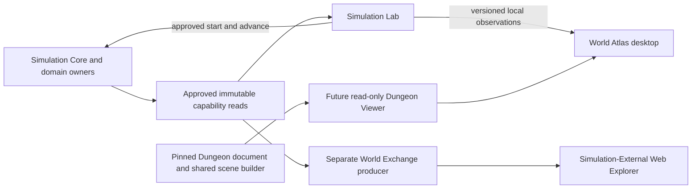

# Simulation World Atlas

**Product direction** `PRODUCT_DIRECTION_APPROVED` by the 2026-11-25 mission. **Architecture** `ARCHITECTURE_PROPOSED`, subject to its independent review and canonical decision. This proposal specifies a read-only standalone consumer and a bounded Lab observation path. Read the [source and dependency matrix](WORLD_ATLAS_DEPENDENCY_MATRIX.md), [observation contract](WORLD_ATLAS_AND_LAB_INTEGRATION.md) and [implementation handoff](WORLD_ATLAS_MVP_HANDOFF.md) together.

## Application and ownership

Choose a Windows x64 Avalonia desktop application on .NET 10, consistent with the existing Dungeon Studio desktop project. Use a custom 2D viewport, native file opening and lightweight inspectors. Verify the pinned SDK, Avalonia version and transitive licenses in the implementation candidate. Qualify other desktop platforms when needed. [Avalonia platform documentation](https://docs.avaloniaui.net/docs/supported-platforms)

| Alternative | Tradeoff |
|---|---|
| Browser | Strong for sharing a portable artifact. Simulation-External already owns the Web Explorer, its TypeScript validation and its public exchange. A new browser application adds packaging and local-file workflow costs without improving the first offline observation loop. |
| Unity | Useful for a later in-game overlay or 3D. It can render vector content, but using it for the first inspector makes ordinary map work depend on Unity imports, Library and player/editor compatibility. [Unity 2D rendering](https://docs.unity3d.com/6000.3/Documentation/Manual/UIE-generate-2d-visual-content.html) |
| Presentation-neutral contract | Adopt it at the observation-file boundary from the start. Ship one desktop client. A later Web Explorer adapter needs a contract fit review, and another frontend should reuse the read semantics. |

Core determines World Truth, lifecycle, clock, changes and event meaning. Lab runs a supported scenario and records coherent observations. The Atlas opens them, maintains in-memory presentation indexes and owns camera, zoom, selection, filters, window/panel state and visual preferences. A future time button must submit intent to the approved Lab/Core lifecycle and wait for a new observation. Atlas has no Core or Unity reference in its initial solution. A detached file remains a recorded view even if the producing process has advanced. An authored map, a factual projection, a persistence image and UI state have separate lifecycles. Derived marker layout and visual labels are presentation values.

## World map and navigation

Use a WorldId-scoped entity key `(kind, sourceId)`. P8 uses typed HexId and LocationId and integer axial `q,r` under `axial-hex-v1`; a LocationRecord carries the authoritative AnchorHexId. Axial neighbor geometry is distinct from registered routes, passages, traversal permission and actor Knowledge. Preserve terrain definition identity plus authored revision when supplied. A legacy Hex without coordinates goes in a list/inspector; it cannot be plotted by filling an arbitrary tile. Recenter coordinates before screen transforms and protect arithmetic at axial int bounds. Pan, zoom and hit testing use a projection-local coordinate system, deterministic tie order and stable IDs. A Location marker uses a symbol anchored to its Hex, with a deterministic visual offset/list when several Locations share it. It claims no precise point inside the Hex. World scale metadata may inform a scale legend only when supplied by its authority.

World → Hex → Location works immediately when those capabilities are projected. Add a Region selector only when authoritative region membership exists; a viewport filter has no Region identity. City and ExplorableSite appear under a Location only where an approved binding resolves the relevant City/site identity to that exact LocationId. Unbound City records are accessible from the World inspector. A missing parent, unsupported detailed map or nonprojectable coordinate yields a factual panel and clear availability status. Use ordered breadcrumbs by stable key, never a name join. Do not invent a Region or City placement for the first real scenario.

At detailed scales, a separate City document or Dungeon floor has its own units, origin and axes. Drill-down changes the local viewport and preserves the semantic parent link. There is no automatic conversion from a dungeon centimeter to a world Hex scale. Use an explicit versioned transform only if a future approved binding calls for one. Hexroll inspires pan/zoom, selected Hex and nearby contextual detail. The supplied sandbox could not be loaded by the research tool; the official guide confirms the interaction pattern. Use original rendering, assets and layout. [Hexroll guide](https://docs.hexroll.app/getting-started/the-hex-map/)

## Dungeon Viewer and City Viewer

Local Dungeon Studio branch `14834671951233ba3e2dff8c8ab1dc81820873ef` has the inspected implementation. Pin a reviewed library release for consumption. First use its `Dungeon.Core` immutable document and `MapScene.Build` for geometry and visual primitives, and `Dungeon.ProjectFiles` for the supported versioned codec. The current scene mixes geometry and editor handles. Extract the read-only Avalonia drawing/hit-test surface under Dungeon ownership once Atlas is a real second consumer. It takes a document/scene, selected floor, transform and optional immutable overlays; suppress edit handles and keep all edit commands, dialogs, sessions and Studio ViewModel outside it. If a lean first adapter is enough, adapt the existing scene without extracting a framework. Use the pinned builder for walls, openings, paths and spline output, including schema v4 support where the library accepts it. Validate via matched scene primitives, sample document and hit tests; no second polygon or spline implementation.

Two distinct modes are useful. **Document preview** opens a user-selected authored document and labels its origin and draft/validation state. **Bound world view** requires a future Simulation-approved immutable binding `(WorldId, SiteInstanceId, LocationId, documentDigest, documentSchema, bindingVersion)` with exact floor/room element keys mapped to typed factual topology/place identities. Resolve active geometry and root coverage at the observation cut or through an immutable artifact with matching digest. A different document revision, site, world or unresolved element disables the affected overlay. Each visible overlay requires its own supported facts. Room descriptions and authored items are document values; current item presence, inhabitants and occupancy need distinct Simulation read capabilities. LocalTopology is a graph and does not supply room polygons. Opening a document adds no world state. Any future import is a separate genesis/runtime decision, with P12 profile admission and P13 causal retention where applicable.

City Studio is `DEFERRED`. Reuse small proven UI pieces once a City Viewer consumes them: viewport transforms and hit-test conventions, selection/breadcrumb keys, inspector presentation, render layers and theming. Domain geometry, lot/road/building rules and documents stay independent. P15-A's inert structure record at an existing Location has identity and creation boundary, not a floor plan, lot geometry, owner or occupants. Structure rows may appear as a list for a supported profile. Households, residence and actual physical occupancy need their own evidence and must be shown as distinct facts.

## NPCs, changes and history

A marker requires an explicitly projected current typed position and a map that can resolve it. City or Location presence gets a grouped marker/list in that context. A Person position is distinct from the NPC runtime projection; bridge only through approved materialization identity. A destination or route plan is an intention. A committed crossing/arrival is a recorded event if projected. In-transit progress can only use a supported travel projection. Interpolation, if added, stays a labelled draw effect between evidence points and never fills in current truth at another boundary. NPC markers, inventory, decision streams and activities are follow-on capabilities.

The Inspector offers four separate kinds of rows: recorded domain events (ID, type, participants, causal order, bounded window and disclosed retention/scope); committed transition evidence (typed receipt or result with its actual meaning and source); observed differences (two coherent comparable values and both boundaries); and UI annotations. Example: stock 420 → 450 is a net observed change; label it production only when an approved typed record proves that causal contribution. Command accepted, action attempted and action completed are separate outcomes. Generic logs, debug read models and history text can aid diagnosis but cannot be elevated to an authoritative event stream. No inference of interactions or absence outside the reported scope.

Atlas can display a current captured cut, compare recorded cuts from one run and display their explicit gaps. P12 continuation recovers one compatible saved state. It supplies neither an arbitrary-day browser nor the missing causal ordering needed by P13. P13 requires exact recoverability of actual simulated boundaries and new WorldId plus provenance on fork. When delivered, Atlas displays reconstructed or forked observations with their source/root provenance and distinct identity. A missing day is unavailable. No interpolation, resimulation, save decoding or rebinding a fork to a parent's ID is needed in the Atlas.
